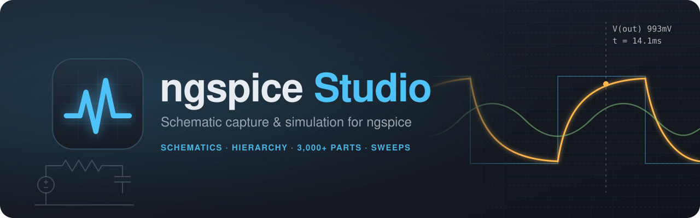
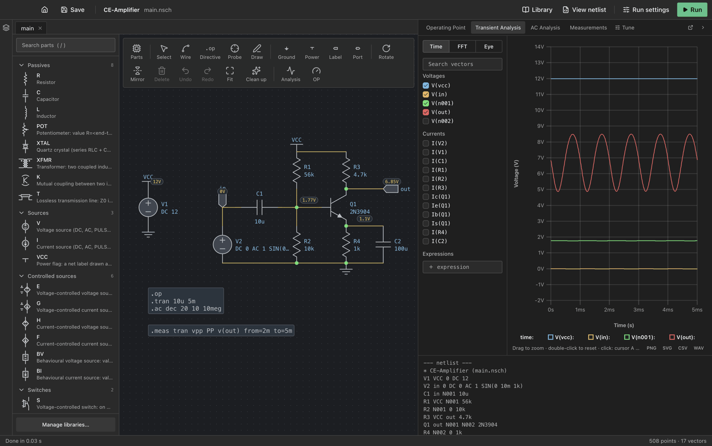
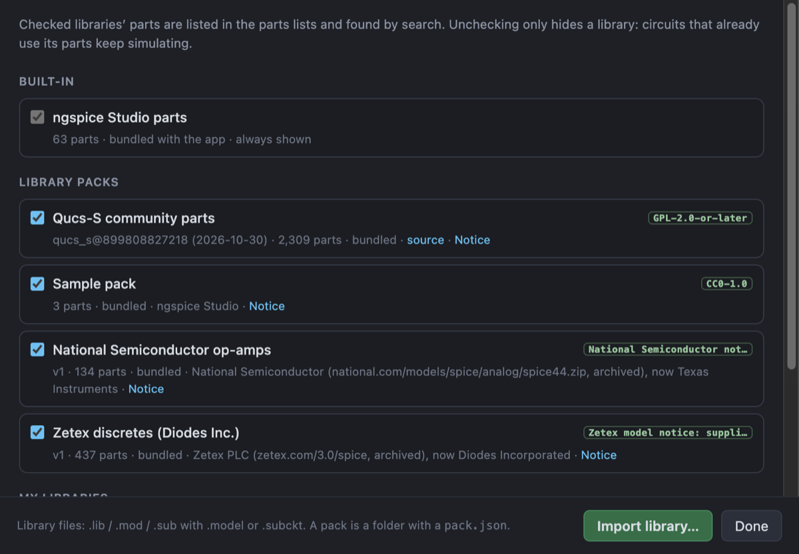
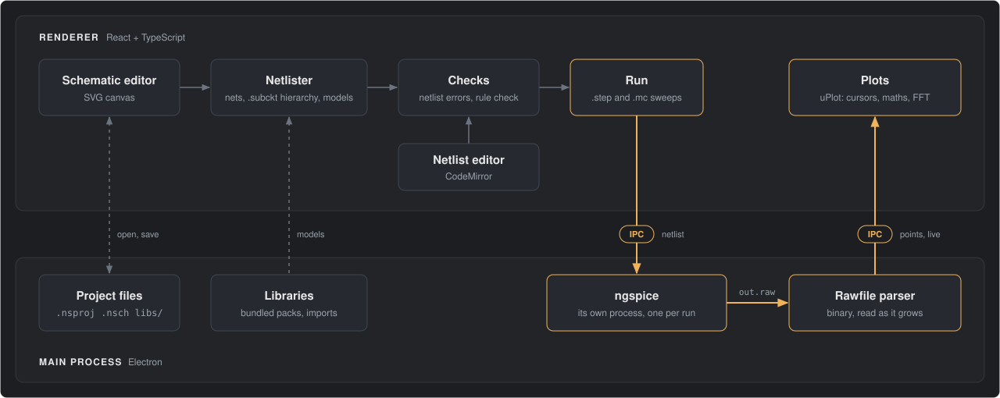

<p align="center">
  <picture>
    <source media="(prefers-color-scheme: dark)" srcset="docs/assets/banner-dark.svg">
    <source media="(prefers-color-scheme: light)" srcset="docs/assets/banner-light.svg">
    
  </picture>
</p>

<p align="center">
  <b>A desktop app for drawing circuits and simulating them with <a href="https://ngspice.sourceforge.io/">ngspice</a>.</b><br>
  Schematics, hierarchical designs, nearly 3,000 ready-to-use parts, probing, sweeps and interactive plots. ngspice is built in.
</p>

<p align="center">
  
  
  
  
  
</p>

<p align="center">
  <a href="#features">Features</a> ·
  <a href="#a-closer-look">Screenshots</a> ·
  <a href="#getting-started">Getting started</a> ·
  <a href="docs/guide/README.md">User guide</a> ·
  <a href="#keyboard-shortcuts">Shortcuts</a> ·
  <a href="#component-libraries">Libraries</a> ·
  <a href="#how-it-works">How it works</a> ·
  <a href="#building-and-packaging">Building</a> ·
  <a href="#roadmap">Roadmap</a>
</p>

<br>

<p align="center">
  
</p>

## Features

<table>
<tr>
<td width="50%" valign="top">

### Schematic capture
- Grid-snapped canvas with orthogonal wires, junction dots, pan and zoom
- Rotate, mirror, copy and paste, multi-select, undo and redo
- Net labels, ground, ports, buses and SPICE directive blocks on the sheet
- Unconnected pins are flagged as you draw, and **Clean up** tidies a crowded sheet
- Import LTspice `.asc` and KiCad `.kicad_sch` schematics

</td>
<td width="50%" valign="top">

### Simulation
- `.op`, `.tran`, `.ac`, `.dc`, `.noise`, `.tf`, `.sens`, `.pz`, `.disto`, `.sp` and `.four`, set up in a dialog with a live preview
- LTspice-style `.step` sweeps, Monte Carlo (`.mc`) and worst-case (`.wc`) runs, with the runs overlaid
- Netlist errors are caught before ngspice runs, and ngspice errors point back to the part that caused them
- A netlist editor with SPICE highlighting, for when you'd rather type the deck

</td>
</tr>
<tr>
<td valign="top">

### Results
- uPlot waveforms with drag to zoom, cursors, expressions, FFT and eye diagrams
- AC results as Bode, Nyquist, polar or Smith charts
- **Probe**: Alt+click a wire for its voltage or a part for its current
- Operating-point voltages shown on the schematic, and `.meas` results in a table
- Sliders that run the simulation again as you tune a value
- Currents get their own axis, and plots pop out into a separate window

</td>
<td valign="top">

### Projects and hierarchy
- Projects with multiple sheets, tabs, templates and recent projects
- **Hierarchical blocks**: put ports on a sheet, place it as a block, double-click to open it
- Each block becomes a SPICE `.subckt`, and circular references are reported as errors
- A bill of materials for the whole design, with CSV and Excel export
- Recovery copies of unsaved work, and a prompt before you quit, close or switch projects with unsaved changes

</td>
</tr>
<tr>
<td valign="top">

### Component libraries
- **Nearly 3,000 parts**: diodes, Zeners, LEDs, BJTs, JFETs, MOSFETs, op-amps, comparators, references, regulators
- Self-written models, each tested in ngspice against its datasheet figures
- Import vendor `.lib` and `.mod` files, with a pin-mapping step
- **Manage Libraries** window: turn libraries on or off, add packs, import files

</td>
<td valign="top">

### Desktop app
- Native menu bar, keyboard shortcuts you can change, collapsible panels
- ngspice is bundled, so you don't install anything else
- Signed macOS builds and a Windows installer
- Open `.nsproj` / `.nsch` files from Finder or Explorer

</td>
</tr>
</table>

## A closer look

<table>
<tr>
<td width="50%"><br><sub><b>Hierarchy.</b> Two copies of a <code>filter.nsch</code> block in cascade, simulated as <code>.subckt</code>s, showing the two-pole roll-off.</sub></td>
<td width="50%"><br><sub><b>Simulation setup.</b> Forms for every analysis, with validation and the exact SPICE line that the dialog writes.</sub></td>
</tr>
<tr>
<td><br><sub><b>Library viewer.</b> Each part's symbol, pin mapping, parameters and SPICE model, by category.</sub></td>
<td><br><sub><b>Manage Libraries.</b> Turn libraries on or off, read their licences, and import more.</sub></td>
</tr>
</table>

## Getting started

New to Spice Studio? The **[user guide](docs/guide/README.md)** walks through drawing, simulating, sweeps, libraries and exporting step by step, with example projects you can open.

### Download

Installers for macOS (Apple silicon and Intel) and Windows are on the [releases page](https://github.com/BMEN90033-Bioinstrumentation/Spice-Studio/releases/latest). ngspice is included, so you don't need to install it separately.

### Run it from source

You need Git and Node.js. The following commands clone the repository, install its dependencies and start the app in development mode:

```sh
git clone https://github.com/BMEN90033-Bioinstrumentation/Spice-Studio.git
cd Spice-Studio
npm install
npm run dev
```

The app needs an ngspice binary. It uses the first one that it finds, in the following order:

1. The program chosen in **Settings › Simulation engine**
2. `NGSPICE_PATH`
3. A bundled build in `vendor/ngspice/<platform>-<arch>/` (see [Building the bundled ngspice](#building-the-bundled-ngspice))
4. Homebrew (`brew install ngspice`)
5. Your `PATH`

The Home page shows which engine is in use.

### Your first simulation

1. On the Home page, click **Examples**, pick one (for example *BJT common-emitter*), and click **Create project**.
2. Click **Run** (⌘↵). The AC and transient plots appear on the right.
3. Alt+click any wire to add its voltage to the plot, or a part to add its current.
4. Press **A** to open the Simulation setup dialog and change the analysis, or add a `.step param` directive to sweep a value.

## Keyboard shortcuts

The following table lists the shortcuts you use most. For the full list, see [Keyboard shortcuts](docs/guide/shortcuts.md).

| Keys | Place | Keys | Edit and view | Keys | Simulate and app |
|---|---|---|---|---|---|
| <kbd>R</kbd> <kbd>C</kbd> <kbd>L</kbd> | resistor, capacitor, inductor | <kbd>Ctrl</kbd>+<kbd>R</kbd>, <kbd>Ctrl</kbd>+<kbd>E</kbd> | rotate, mirror | <kbd>⌘</kbd><kbd>↵</kbd> | run |
| <kbd>V</kbd> <kbd>I</kbd> | voltage source, current source | <kbd>⌘</kbd><kbd>Z</kbd>, <kbd>⇧</kbd><kbd>⌘</kbd><kbd>Z</kbd> | undo, redo | <kbd>A</kbd> | simulation setup |
| <kbd>D</kbd> <kbd>Q</kbd> <kbd>M</kbd> | diode, NPN, NMOS | <kbd>⌘</kbd><kbd>D</kbd> | duplicate | <kbd>P</kbd> or <kbd>Alt</kbd>+click | probe |
| <kbd>G</kbd> <kbd>N</kbd> <kbd>H</kbd> | ground, net label, port | <kbd>F</kbd> | fit to window | <kbd>⌘</kbd><kbd>S</kbd> | save |
| <kbd>W</kbd> | wire (<kbd>/</kbd> flips the corner) | <kbd>⌘</kbd><kbd>1</kbd> <kbd>⌘</kbd><kbd>2</kbd> <kbd>⌘</kbd><kbd>3</kbd> | sheets, parts, plots panels | <kbd>⌘</kbd><kbd>N</kbd>, <kbd>⌘</kbd><kbd>O</kbd> | new project, open project |
| <kbd>S</kbd> | SPICE directive | <kbd>/</kbd> | search parts | <kbd>⌘</kbd><kbd>/</kbd> | all shortcuts |

On Windows and Linux, use <kbd>Ctrl</kbd> where this table says <kbd>⌘</kbd>. Rotate and mirror use <kbd>Ctrl</kbd> on every platform.

## Component libraries

Every part in the app simulates in ngspice. You can switch packs on and off in **Manage Libraries**. Switching a library off only hides it from the lists, so circuits that already use its parts keep working.

The following table lists the libraries that ship with the app:

| Library | Parts | What's in it | Licence |
|---|---:|---|---|
| **Spice Studio parts** (built in) | 85 | Common diodes, Zeners, LEDs, BJTs, JFETs, MOSFETs, op-amp macromodels, a comparator, a TL431 and a 7805. Self-written from datasheet figures; each is tested against those figures. | Part of this repository |
| **Qucs-S community parts** | 2,309 | Diodes, BJTs, JFETs, MOSFETs, op-amps, references, regulators, optocouplers and a 555. Converted from [Qucs-S](https://github.com/ra3xdh/qucs_s) at a pinned commit; parts carrying vendor notices are excluded. | GPL-2.0-or-later |
| **Zetex discretes** (Diodes Inc.) | 437 | BJTs, diodes, MOSFETs and references, shipped byte-identical with the vendor's notice. | Zetex model notice |
| **National Semiconductor op-amps** | 134 | Op-amp and comparator macromodels, shipped byte-identical with the vendor's notice. | National notice (no resale) |
| **Sample pack** | 3 | Two generic diodes and a limiter subcircuit, as a minimal example of how a bundled pack is laid out ([`library-packs/sample/`](library-packs/sample/)). | CC0-1.0 |

Each pack's source, checksums and build notes are in [`library-packs/`](library-packs/), and the scripts that build them are in [`scripts/packs/`](scripts/packs/). To use other vendor models, import the `.lib` or `.mod` file with **Manage Libraries › Import library…**. The file goes into *My libraries*, which every project can use, or into the current project. Project copies travel with the project.

## How it works

<p align="center">
  <picture>
    <source media="(prefers-color-scheme: dark)" srcset="docs/assets/how-it-works-dark.svg">
    <source media="(prefers-color-scheme: light)" srcset="docs/assets/how-it-works-light.svg">
    
  </picture>
</p>

- **Engine:** ngspice runs as a separate batch process for each simulation, so a crashing circuit can't take the app down. Results come back in ngspice's binary rawfile format, parsed in [`src/main/rawfile.ts`](src/main/rawfile.ts).
- **Connectivity:** the netlist follows the same rules the editor uses to draw connections. Wire ends and pins join where they meet, a wire ending on another wire makes a T-junction, and a pin never connects to the middle of a wire.
- **Files:** projects are plain JSON (`.nsproj`, `.nsch`) next to their sheets and a `libs/` folder.

<details>
<summary><b>Repository layout</b></summary>

```text
src/
  main/            Electron main process: ngspice runner, rawfile parser, menus, project & library IPC
  preload/         the typed window.api bridge
  renderer/src/
    schematic/     model, symbols, netlister, templates, canvas editor
    sim/           analysis forms, .step sweeps, probing, error blame
    library/       library data, parser, panel, viewer, Manage Libraries
    layout/        collapsible panels, pop-out windows
    project/ home/ projects and the Home page
library-packs/     bundled packs (pack.json, models, notices, build notes)
scripts/           ngspice build scripts, pack builders
test/              node:test suites, many running real ngspice
```

</details>

## Building and packaging

The following commands run the tests, check the types and build the production bundle:

```sh
npm test            # 100+ tests (node --test), many simulate in real ngspice
npx tsc --noEmit    # typecheck
npm run build       # production bundle
```

### Building the bundled ngspice

ngspice is built from source into a self-contained, relocatable folder at `vendor/ngspice/<platform>-<arch>/`. It includes XSPICE code models and the KLU solver, and depends on nothing outside the system libraries.

To build it, clone the ngspice source next to the app and run the build script for your platform:

```sh
git clone https://git.code.sf.net/p/ngspice/ngspice ngspice-ngspice
npm run ngspice:build               # macOS / Linux (needs autoconf automake libtool bison flex)
bash scripts/build-ngspice-win.sh   # Windows, from an MSYS2 MINGW64 shell
```

### Installers

Each of the following commands builds the installers for one platform:

```sh
npm run dist:mac      # .dmg + .zip  (MAC_ARCH=x64 or arm64,x64 to change)
npm run dist:win      # NSIS installer
npm run dist:linux    # AppImage + .deb
```

<details>
<summary><b>Code signing, notarisation and CI</b></summary>

- **macOS:** with a *Developer ID Application* identity in the keychain (or `CSC_LINK` + `CSC_KEY_PASSWORD`), the app and the bundled ngspice are signed under the hardened runtime. Notarisation runs when `APPLE_ID` + `APPLE_APP_SPECIFIC_PASSWORD` + `APPLE_TEAM_ID` (or an App Store Connect API key) are set. Without credentials the build is ad-hoc signed, so it runs on the machine that built it.
- **Windows:** set `CSC_LINK` / `CSC_KEY_PASSWORD` to a code-signing `.pfx`. Without them, SmartScreen shows a warning.
- **CI:** [`.github/workflows/release.yml`](.github/workflows/release.yml) builds ngspice and the installers on macOS (arm64 and x64), Windows and Linux. Pushing a `v*` tag attaches them to a draft release. The signing secrets are optional.

</details>

## Roadmap

Planned features are tracked as [enhancement issues](https://github.com/BMEN90033-Bioinstrumentation/Spice-Studio/issues?q=is%3Aissue+is%3Aopen+label%3Aenhancement). Open one there to suggest something.

## Licences

- **ngspice** is bundled unmodified, and its `COPYING` and third-party notices ship inside the app. It's mostly Modified BSD, with LGPL (KLU, numparam), MPL-2.0 (OSDI) and GPL (`table.cm`) parts. The notices say where to get the exact source.
- **Library packs** carry their own licences and notices (see the [component libraries](#component-libraries) table and each pack's `NOTICE` file). You can read all of them in the app under **Help › Third-party Licences**.
- **Spice Studio's own code** is licensed under [GPL-3.0-only](LICENSE).

<p align="center"><sub>Built with Electron, React, CodeMirror and uPlot, on top of <a href="https://ngspice.sourceforge.io/">ngspice</a>.</sub></p>
