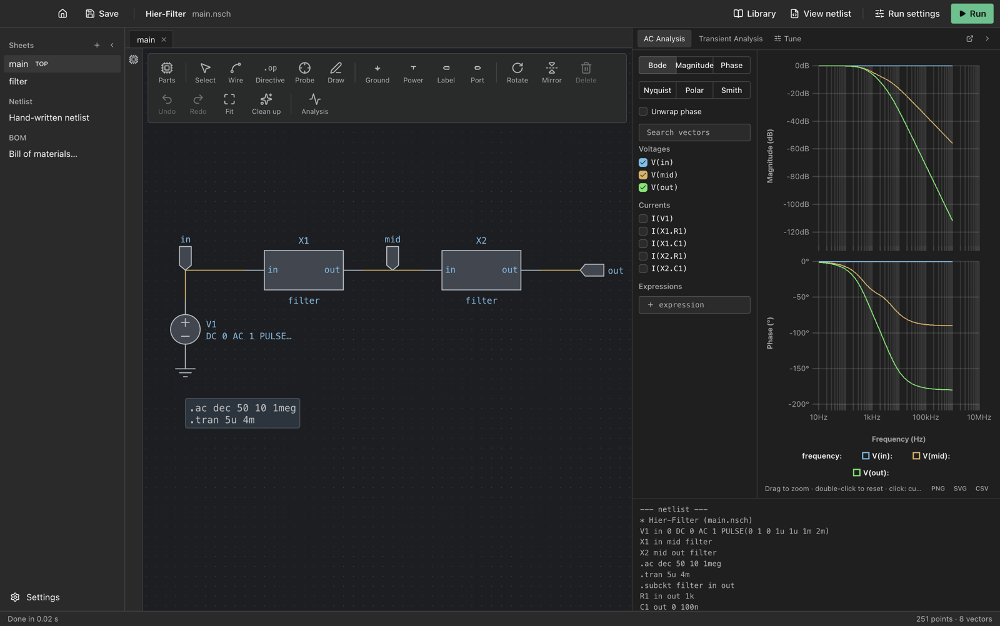
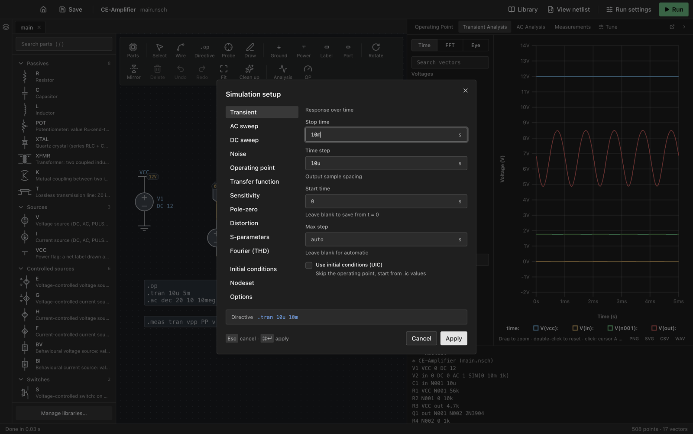
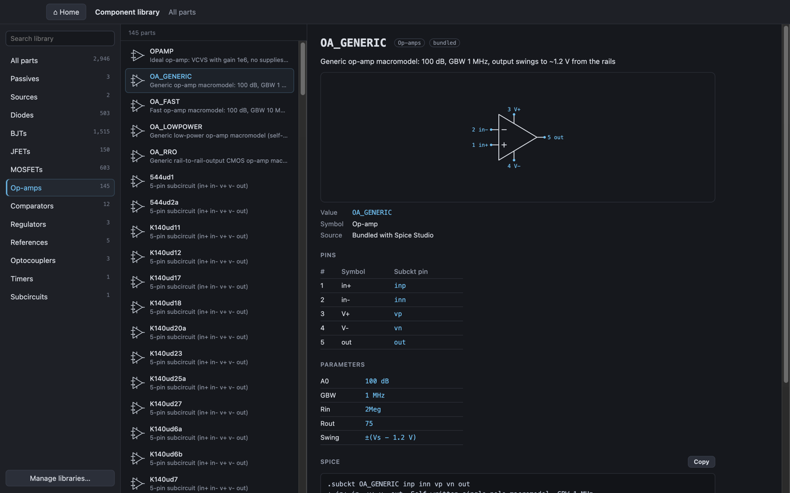
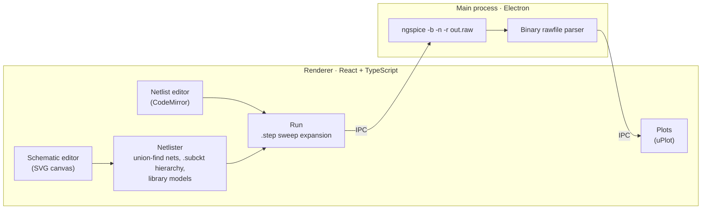

<p align="center">
  <picture>
    <source media="(prefers-color-scheme: dark)" srcset="docs/assets/banner-dark.svg">
    <source media="(prefers-color-scheme: light)" srcset="docs/assets/banner-light.svg">
    
  </picture>
</p>

<p align="center">
  <b>A modern desktop app for drawing circuits and simulating them with <a href="https://ngspice.sourceforge.io/">ngspice</a>.</b><br>
  Schematics, hierarchical designs, 3,000+ ready-to-use parts, probing, sweeps and fast interactive plots. ngspice is built in.
</p>

<p align="center">
  
  
  
  
  
</p>

<p align="center">
  <a href="#features">Features</a> ·
  <a href="#a-closer-look">Screenshots</a> ·
  <a href="#getting-started">Getting started</a> ·
  <a href="#keyboard-shortcuts">Shortcuts</a> ·
  <a href="#component-libraries">Libraries</a> ·
  <a href="#how-it-works">How it works</a> ·
  <a href="#building-and-packaging">Building</a> ·
  <a href="#roadmap">Roadmap</a>
</p>

<br>

<p align="center">
  
</p>

## Features

<table>
<tr>
<td width="50%" valign="top">

### ✏️ Schematic capture
- Grid-snapped canvas with orthogonal wires, junction dots and pan/zoom
- Rotate, mirror, copy/paste, multi-select, undo/redo
- Net labels, ground, ports, and SPICE directive blocks on the sheet
- Unconnected pins are flagged as you draw

</td>
<td width="50%" valign="top">

### ⚡ Simulation
- `.op`, `.tran`, `.ac`, `.dc` and `.noise`, set up in a dialog with a live preview
- LTspice-style `.step` parameter sweeps, with the runs overlaid
- Netlist errors are caught before ngspice runs, and ngspice errors point back to the part that caused them
- The netlist editor (with SPICE highlighting) is there when you want it

</td>
</tr>
<tr>
<td valign="top">

### 📈 Results
- Fast uPlot waveforms: drag to zoom, magnitude/phase, log-frequency axes
- **Probe**: Alt+click a wire for its voltage or a part for its current
- Operating-point voltages shown right on the schematic
- Currents on their own axis; plots pop out into a separate window

</td>
<td valign="top">

### 🗂️ Projects & hierarchy
- Projects with multiple sheets, tabs, templates and recent projects
- **Hierarchical blocks**: put ports on a sheet, place it as a block, double-click to open it
- Each block becomes a SPICE `.subckt`; circular references are reported as errors
- Your work is guarded against loss on quit, close and switching projects

</td>
</tr>
<tr>
<td valign="top">

### 🧩 Component libraries
- **3,000+ parts**: diodes, Zeners, LEDs, BJTs, JFETs, MOSFETs, op-amps, comparators, references, regulators
- Self-written models, each tested in ngspice against its datasheet figures
- Import vendor `.lib`/`.mod` files, with a pin-mapping step
- **Manage Libraries** window: turn libraries on or off, add packs, import files

</td>
<td valign="top">

### 🖥️ A real desktop app
- Native menu bar, keyboard shortcuts, collapsible panels
- ngspice is bundled: nothing else to install
- Signed macOS builds; Windows and Linux installers
- Open `.nsproj` / `.nsch` files from Finder or Explorer

</td>
</tr>
</table>

## A closer look

<table>
<tr>
<td width="50%"><br><sub><b>Hierarchy.</b> Two copies of a <code>filter.nsch</code> block in cascade, simulated as <code>.subckt</code>s, showing the two-pole roll-off.</sub></td>
<td width="50%"><br><sub><b>Simulation setup.</b> Forms for every analysis, with validation and the exact SPICE line that will be written.</sub></td>
</tr>
<tr>
<td><br><sub><b>Library viewer.</b> Each part's symbol, pin mapping, parameters and SPICE model, by category.</sub></td>
<td><br><sub><b>Manage Libraries.</b> Turn libraries on or off, read their licences, and import more.</sub></td>
</tr>
</table>

## Getting started

### Run it from source

```sh
git clone https://github.com/BMEN90033-Bioinstrumentation/Ngspice_tool.git
cd Ngspice_tool
npm install
npm run dev
```

The app needs an ngspice binary. It looks in this order:

1. `NGSPICE_PATH`
2. a bundled build in `vendor/ngspice/<platform>-<arch>/` (see [Building ngspice](#building-the-bundled-ngspice))
3. Homebrew (`brew install ngspice`)
4. your `PATH`

The Home page shows which engine is in use.

### Your first simulation

1. **New project** (⌘N), then pick a template, for example *BJT common-emitter amplifier*.
2. Press **Run** (⌘↵). The AC and transient plots appear on the right.
3. Alt+click any wire to add its voltage to the plot, or a part for its current.
4. Press **A** for *Simulation setup* to change the analysis, or add a `.step param …` directive to sweep a value.

## Keyboard shortcuts

| Place | | Edit & view | | Simulate & app | |
|---|---|---|---|---|---|
| <kbd>R</kbd> <kbd>C</kbd> <kbd>L</kbd> | resistor, capacitor, inductor | <kbd>Ctrl</kbd> <kbd>R</kbd> / <kbd>Ctrl</kbd> <kbd>E</kbd> | rotate / mirror | <kbd>⌘</kbd> <kbd>↵</kbd> | run |
| <kbd>V</kbd> <kbd>I</kbd> | voltage / current source | <kbd>⌘</kbd> <kbd>Z</kbd> / <kbd>⇧</kbd> <kbd>⌘</kbd> <kbd>Z</kbd> | undo / redo | <kbd>A</kbd> | simulation setup |
| <kbd>D</kbd> <kbd>Q</kbd> <kbd>M</kbd> | diode, NPN, NMOS | <kbd>⌘</kbd> <kbd>D</kbd> | duplicate | <kbd>P</kbd> or <kbd>Alt</kbd>+click | probe |
| <kbd>G</kbd> <kbd>N</kbd> <kbd>H</kbd> | ground, net label, port | <kbd>F</kbd> | fit to window | <kbd>⌘</kbd> <kbd>S</kbd> | save |
| <kbd>W</kbd> | wire (<kbd>/</kbd> flips the corner) | <kbd>⌘</kbd> <kbd>1</kbd> <kbd>2</kbd> <kbd>3</kbd> | sheets / parts / plots panels | <kbd>⌘</kbd> <kbd>N</kbd> / <kbd>⌘</kbd> <kbd>O</kbd> | new / open project |
| <kbd>S</kbd> | SPICE directive | <kbd>/</kbd> | search parts | <kbd>⌘</kbd> <kbd>/</kbd> | all shortcuts |

On Windows and Linux, use <kbd>Ctrl</kbd> where this table says <kbd>⌘</kbd>.

## Component libraries

Every part in the app simulates in ngspice. Packs can be switched on and off in **Manage Libraries**. A switched-off library is only hidden from the lists: circuits already using its parts keep working.

| Library | Parts | What's in it | Licence |
|---|---:|---|---|
| **Spice Studio parts** (built in) | 63 | Common diodes, Zeners, LEDs, BJTs, JFETs, MOSFETs, op-amp macromodels, a comparator, a TL431 and a 7805. Self-written from datasheet figures; each is tested against those figures. | Part of this repository |
| **Qucs-S community parts** | 2,309 | Diodes, BJTs, JFETs, MOSFETs, op-amps, references, regulators, optocouplers and a 555. Converted from [Qucs-S](https://github.com/ra3xdh/qucs_s) at a pinned commit; parts carrying vendor notices are excluded. | GPL-2.0-or-later |
| **Zetex discretes** (Diodes Inc.) | 437 | BJTs, diodes, MOSFETs and references, shipped byte-identical with the vendor's notice. | Zetex model notice |
| **National Semiconductor op-amps** | 134 | Op-amp and comparator macromodels, shipped byte-identical with the vendor's notice. | National notice (no resale) |

Each pack's source, checksums and build notes are in [`library-packs/`](library-packs/), and the scripts that build them are in [`scripts/packs/`](scripts/packs/). To use other vendor models, import the `.lib`/`.mod` file through **Manage Libraries → Import library…**. It goes into *My libraries* (available in every project) or into the current project, and project copies travel with the project.

## How it works



- **Engine:** ngspice runs as a separate batch process for each simulation, so a crashing circuit can't take the app down. Results come back in ngspice's binary rawfile format, parsed in [`src/main/rawfile.ts`](src/main/rawfile.ts).
- **Connectivity:** the netlist follows the same rules the editor uses to draw connections. Wire ends and pins join where they meet, a wire ending on another wire makes a T-junction, and a pin never connects to the middle of a wire.
- **Files:** projects are plain JSON (`.nsproj`, `.nsch`) next to their sheets and a `libs/` folder.

<details>
<summary><b>Repository layout</b></summary>

```
src/
  main/            Electron main process: ngspice runner, rawfile parser, menus, project & library IPC
  preload/         the typed window.api bridge
  renderer/src/
    schematic/     model, symbols, netlister, templates, canvas editor
    sim/           analysis forms, .step sweeps, probing, error blame
    library/       library data, parser, panel, viewer, Manage Libraries
    layout/        collapsible panels, pop-out windows
    project/ home/ projects and the Home page
library-packs/     bundled packs (pack.json, models, notices, build notes)
scripts/           ngspice build scripts, pack builders
test/              node:test suites, many running real ngspice
```

</details>

## Building and packaging

```sh
npm test            # 100+ tests (node --test), many simulate in real ngspice
npx tsc --noEmit    # typecheck
npm run build       # production bundle
```

### Building the bundled ngspice

ngspice is built from source into a self-contained, relocatable folder at `vendor/ngspice/<platform>-<arch>/`. It includes XSPICE code models and the KLU solver, and depends on nothing outside the system libraries.

```sh
git clone https://git.code.sf.net/p/ngspice/ngspice ngspice-ngspice
npm run ngspice:build               # macOS / Linux (needs autoconf automake libtool bison flex)
bash scripts/build-ngspice-win.sh   # Windows, from an MSYS2 MINGW64 shell
```

### Installers

```sh
npm run dist:mac      # .dmg + .zip  (MAC_ARCH=x64 or arm64,x64 to change)
npm run dist:win      # NSIS installer
npm run dist:linux    # AppImage + .deb
```

<details>
<summary><b>Code signing, notarisation and CI</b></summary>

- **macOS:** with a *Developer ID Application* identity in the keychain (or `CSC_LINK` + `CSC_KEY_PASSWORD`), the app and the bundled ngspice are signed under the hardened runtime. Notarisation runs when `APPLE_ID` + `APPLE_APP_SPECIFIC_PASSWORD` + `APPLE_TEAM_ID` (or an App Store Connect API key) are set. Without credentials the build is ad-hoc signed: it runs on the machine that built it.
- **Windows:** set `CSC_LINK` / `CSC_KEY_PASSWORD` to a code-signing `.pfx`; otherwise SmartScreen will warn.
- **CI:** [`.github/workflows/release.yml`](.github/workflows/release.yml) builds ngspice and the installers on macOS (arm64 and x64), Windows and Linux. Pushing a `v*` tag attaches them to a draft release. The signing secrets are optional.

</details>

## Roadmap

- [ ] Dependent and behavioural sources (E/F/G/H, B), switches, transformers (K)
- [ ] Stop button and timeouts for long runs, with live progress
- [ ] Cursors with Δ readouts, waveform maths, FFT
- [ ] Source waveform editor (PULSE, SIN, PWL…) and `.options` / convergence help
- [ ] Export plots (PNG/SVG/CSV) and schematics (SVG/PDF)
- [ ] Electrical rule check before simulating
- [ ] PSpice/LTspice compatibility mode for imported vendor models
- [ ] `.meas` results table, temperature sweeps, Monte Carlo
- [ ] Digital / mixed-signal (XSPICE) parts and waveform view

## Licences

- **ngspice** is bundled unmodified, and its `COPYING` and third-party notices ship inside the app. It is mostly Modified BSD, with LGPL (KLU, numparam), MPL-2.0 (OSDI) and GPL (`table.cm`) parts. The notices say where to get the exact source.
- **Library packs** carry their own licences and notices (see the table above and each pack's `NOTICE` file). All of them are viewable in the app under *Help → Third-party Licences*.
- **Spice Studio's own code** doesn't have a licence yet.

<p align="center"><sub>Built with Electron, React, CodeMirror and uPlot, on top of the excellent <a href="https://ngspice.sourceforge.io/">ngspice</a>.</sub></p>
