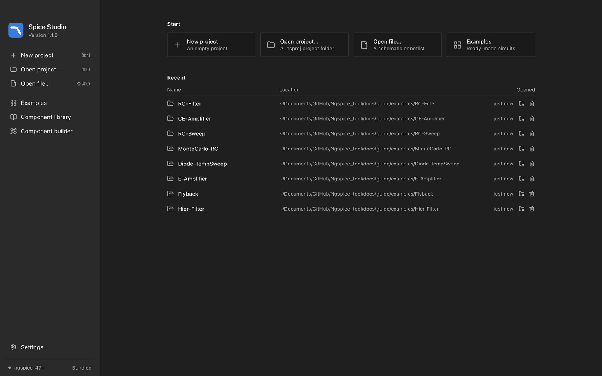
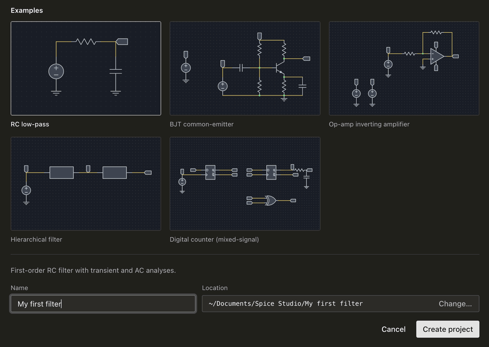
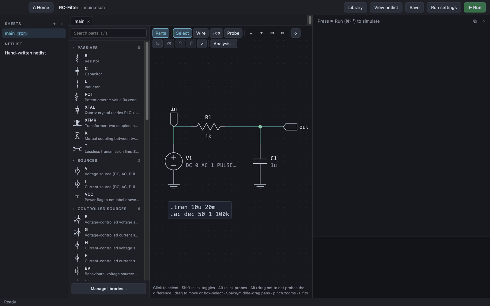
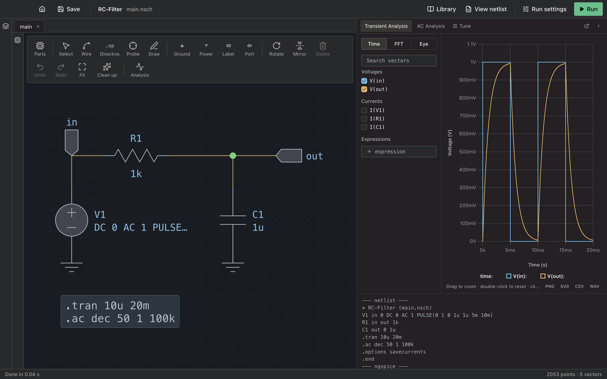
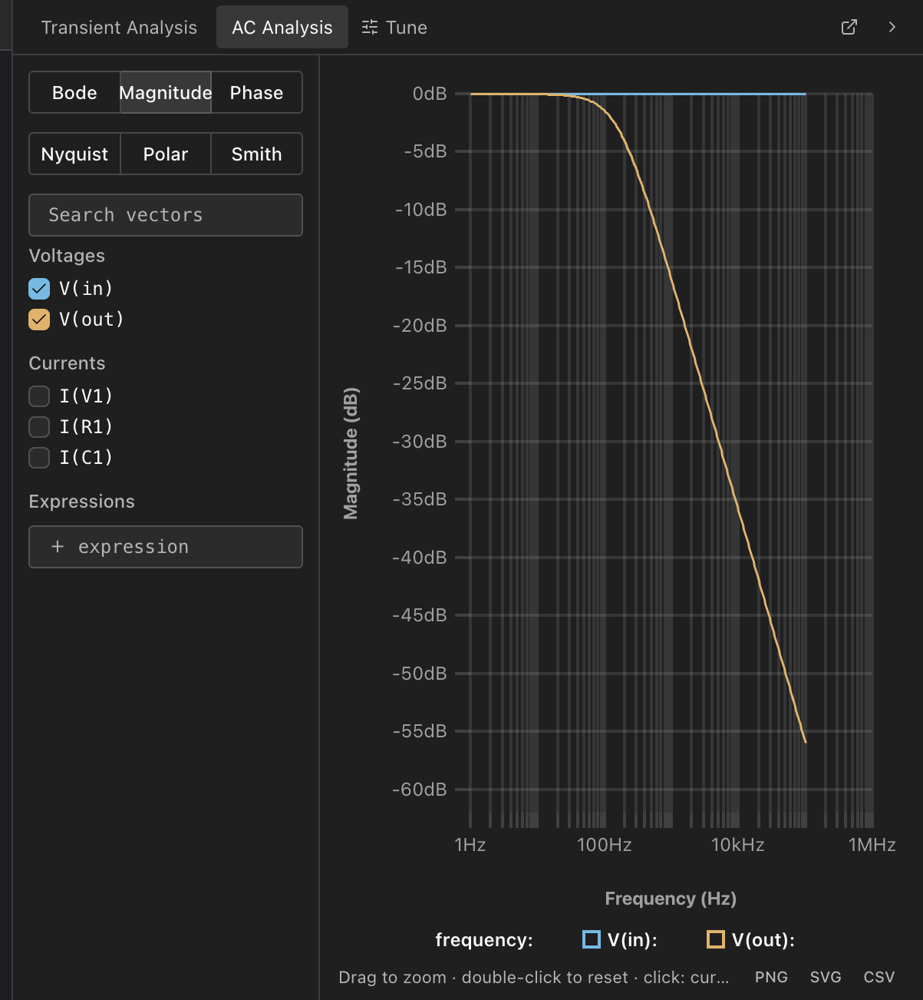

# 1. Getting started

[Guide index](README.md) · Next: [Drawing schematics](02-drawing-schematics.md)

## Install and run

Spice Studio runs from source with Node.js:

```sh
git clone https://github.com/BMEN90033-Bioinstrumentation/Ngspice_tool.git
cd Ngspice_tool
npm install
npm run dev
```

The app needs an ngspice program. It uses the first one it finds: the program you chose in [Settings](#settings), the `NGSPICE_PATH` environment variable, a bundled build in `vendor/ngspice/`, Homebrew (`brew install ngspice`), then your `PATH`. The [project README](../../README.md#run-it-from-source) has the details, and [Building and packaging](../../README.md#building-and-packaging) explains how to build the bundled ngspice and the installers.

## The Home page

The app opens on the Home page.



- **New project** (⌘N) creates an empty project folder.
- **Open project** (⌘O) opens a `.nsproj` file.
- **Open file** (⇧⌘O) opens a single `.nsch` schematic or `.cir` netlist without a project.
- **Examples** shows ready-made circuits to start a project from.
- **Recent projects** lists the projects you opened before. Click one to open it.
- **Component library** browses the parts and their models (see [chapter 8](08-libraries.md)).

The top-right corner shows which ngspice the app found, for example `ngspice-47+ (bundled)`. If it is red, no ngspice was found and nothing will simulate.

## Create a project

1. Click **New project** or press ⌘N for an empty project. To start from a ready-made circuit instead, click **Examples** and pick one: *RC low-pass*, *BJT common-emitter*, *Op-amp inverting amplifier*, *Hierarchical filter* or *Digital counter (mixed-signal)*.
2. Type a **Name**. The name becomes the folder name, so it can't contain `/ \ : * ? " < > |` or start with a dot.
3. Check the **Location**. By default projects go in `Documents/Spice Studio`. Click **Change…** to pick another folder, or change the default in [Settings](#settings).
4. Click **Create project**.



The project opens in the editor. A project is a folder holding a `<Name>.nsproj` file, one `.nsch` file per sheet (the first is `main.nsch`) and a `libs/` folder for imported models.

## Your first simulation: an RC low-pass filter

This section draws a 1 kΩ / 1 µF low-pass filter (corner frequency 1/(2π·RC) ≈ 159 Hz) and runs a transient and an AC analysis. The finished project is [examples/RC-Filter](examples/RC-Filter/); the *RC low-pass* example gives you the same circuit.

### Draw it

Start from a new, empty project. [Chapter 2](02-drawing-schematics.md) explains each tool in detail.

1. Press **V** and click on the canvas to place a voltage source, V1. Press **Esc** to stop placing.
2. Press **R**, then **Ctrl+R** to turn the resistor sideways, and click to the upper right of V1.
3. Press **C** and click to the right of the resistor to place the capacitor.
4. Press **G** and click below V1 and below the capacitor to place two grounds. Each ground symbol must sit on a pin end.
5. Press **W** and wire V1's top pin to the resistor's left end, and the resistor's right end to the capacitor's top. Click once to start, click on the far pin to finish.
6. Press **N** and click exactly on C1's top pin, where the wire meets it, to add a net label. A label only connects at a pin end or a wire end, not halfway along a wire. Select the label and type `out` in **Net name**. Naming the net makes it easy to find in the results.



### Set the source

1. Double-click V1. Its properties open in a popup beside it (Enter on a selected part, or **Properties…** in the right-click menu, opens it too; Esc closes it).
2. Click **Waveform…**.
3. Set **DC value** to `0` and **AC magnitude** to `1`.
4. Set **Transient waveform** to *Pulse* and fill in 0, 1, 0, 1u, 1u, 5m and 10m (initial value, pulsed value, delay, rise, fall, width, period).
5. Click **Apply**. V1's value becomes `DC 0 AC 1 PULSE(0 1 0 1u 1u 5m 10m)`.

The AC magnitude is used by the AC analysis; the pulse is used by the transient analysis.

### Add the analyses

1. Press **S** (or click the **.op** button in the toolbar) and click below the circuit. A directive card with `.op` appears and its text opens in a popup beside it.
2. Replace the text with two lines:

   ```
   .tran 10u 20m
   .ac dec 50 1 100k
   ```

`.tran 10u 20m` simulates 20 ms in 10 µs output steps. `.ac dec 50 1 100k` sweeps from 1 Hz to 100 kHz with 50 points per decade. You can also build each line in the **Analysis** dialog (press **A**); see [chapter 4](04-simulating.md).

### Run

Click **▶ Run** in the top-right corner, or press ⌘↵. A project always simulates its top sheet.

The results panel on the right gets one tab per analysis. The transient tab shows the square wave at `in` and the charging curve at `out`:



The **AC Analysis** tab shows the magnitude in dB on a log-frequency axis. The `out` curve is −3 dB at about 159 Hz and falls at 20 dB per decade above that:



Below the plot, the console shows the netlist the app generated and ngspice's output. The status bar at the bottom says `Done in … s` when the run worked.

### Save

Press ⌘S, or click **Save**, to save every changed sheet. Unsaved sheets show a • after their name. If you go back Home or open another project with unsaved changes, the app asks you to **Save**, **Discard** or **Cancel**.

### If the app quits unexpectedly

While you have unsaved changes, the app keeps a recovery copy of them: every 30 seconds, when you pause for a moment and when you switch to another window. The copy goes in the app's own settings folder, never over your files. Saving, or choosing **Discard** when you close, removes it.

If the app crashes or is force-quit, the Home page shows **Unsaved work from an earlier session** the next time you start it, with the project or file, the sheets that changed and when. Opening that project or file again also asks first.

- **Restore** opens the project with the changes put back. They are marked unsaved (•): your files on disk stay as they were until you press ⌘S.
- **Discard** deletes the recovery copy.
- **Later** (when opening a project) opens your saved files and keeps the copy for next time.

If a saved file changed after the copy was made (you saved it since, or it was edited outside Spice Studio, renamed or deleted), the app lists those files before restoring anything:

- **Keep saved files** keeps those files as they are on disk and restores only the rest of the copy.
- **Use recovered copy** brings back the copy's version of them too, as unsaved changes. Saving then replaces the newer files.
- **Cancel** (or **Later**) leaves everything as it is.

If the project itself was moved, renamed or deleted, **Restore** on the Home page offers **Locate project…** to restore into it where it is now, or **Save as files…** to save each recovered sheet (and the netlist) wherever you choose.

You can change how often copies are made, or turn them off, in [Settings](#settings). With copies turned off, a copy you restored is still removed once you save or discard.

## Settings

Open Settings with ⌘, (**Spice Studio › Settings…** on macOS, **File › Preferences…** on Windows), or click **Settings** at the bottom of the Home page's sidebar. Settings fills the window, with a tab down the left for each section: Appearance, Schematic, Autosave, New projects and files, Simulation engine, Keyboard shortcuts and About. **Back** at the top left (or Esc) returns to where you were. Changes apply at once to every open window, and are kept for next time.

- **Theme**: **Light**, **Dark** or **System** (follows your computer's setting). Dark is the default. Exported and printed schematics are always black on white.
- **Appearance** also has **Interface scale** (80 % to 150 %, for every window) and **Netlist text size** for the netlist editor.
- **Schematic**: show or hide the grid, and whether operating-point values appear on the schematic after a run. The **OP** button on the canvas toolbar still turns them on and off for the sheet you are on.
- **Schematic** also has the **Grid style** (dots or lines), the **Label text size** for part names and values, the **Line weight** of symbols and wires, and what the **Scroll wheel** does: pan (the default; pinch or Ctrl+wheel zooms) or zoom (Shift+wheel then pans).
- **Simulation and plots**: whether waveforms are drawn while a simulation runs, and the **Trace thickness** of plots.
- **Autosave**: keep recovery copies of unsaved work, and how often (5 to 600 seconds).
- **Keyboard shortcuts**: every shortcut that can be changed, by group. Click one and press the new keys; Esc cancels, and Backspace leaves the command with no shortcut. A key that is already taken, or one of the standard editing keys, is refused with the reason. The arrow beside a changed shortcut puts it back, and **Reset all** restores every default. Menus and tooltips show your keys. The fixed keys (undo, copy and paste, Esc, zoom and the mouse gestures) are listed at the bottom.
- **New projects and files**: the folder New project suggests, and the compatibility mode and timeout that new projects and single files start with. Each project then keeps its own in **Run settings** ([chapter 4](04-simulating.md#run-settings)).
- **Simulation engine**: the ngspice the app uses, its version and where it is. **Choose…** picks another ngspice program; **Use bundled** goes back to the built-in one. If the chosen program doesn't run, this shows the error.

Next: [Drawing schematics](02-drawing-schematics.md).
