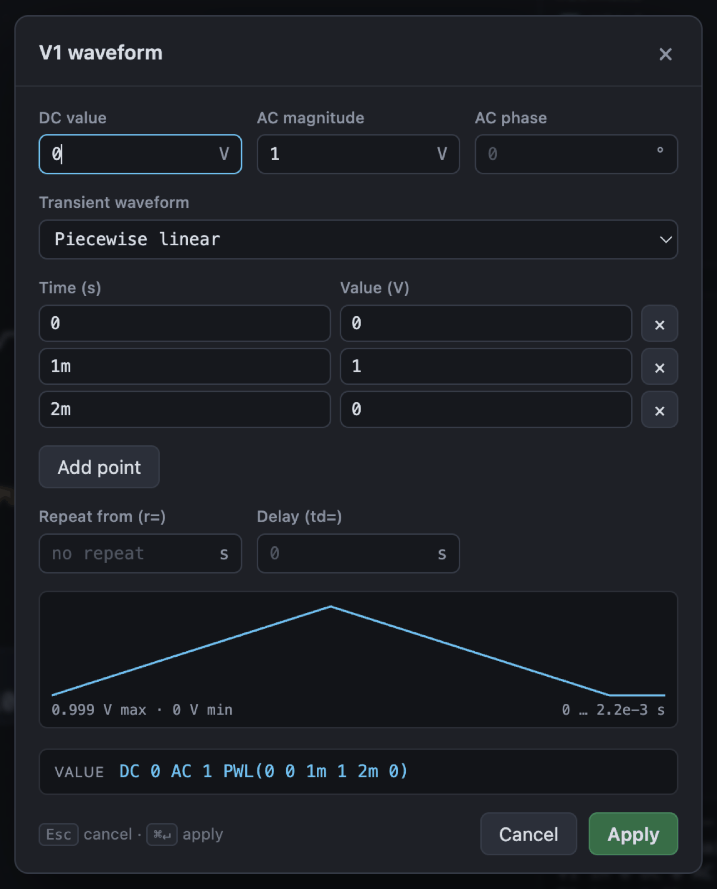

# 2. Drawing schematics

[Guide index](README.md) · Previous: [Getting started](01-getting-started.md) · Next: [Component reference](03-components.md)

The schematic editor is the canvas in the middle of the window. The toolbar above it holds the drawing tools, and the hint line at the bottom says what the current tool does. The toolbar stays on one row, centred over the canvas: in a narrow window its buttons get smaller instead of wrapping.

A toolbar button with a small arrow, such as **Draw**, holds a menu of tools: point at it or click it to open the menu. **Edit** at the end of the toolbar changes the toolbar itself: while its panel is open, drag a button along the toolbar (or a row in the panel) to where it should go, click **×** to remove a tool, and pick from **Add to the toolbar** to add any other tool, part or separator. **Reset** brings back the standard layout, and **Done**, **Esc** or a click on the canvas finishes. The layout is saved with your settings.

## Moving around

You can move around the canvas in the following ways:

- **Zoom**: turn the scroll wheel, pinch on a trackpad, or press **+** and **−**. The zoom stays centred on the pointer.
- **Pan**: hold **Shift** and scroll, hold **Space** and drag, or drag with the middle button.
- To make the wheel (and a two-finger trackpad scroll) pan instead, set **Settings › Schematic › Scroll wheel** to pan. Pinch and Ctrl + wheel still zoom.
- **Fit**: press **F** or click **⤢** to fit the whole drawing in the window.
- **Panels**: ⌘1 shows or hides the Sheets panel, ⌘2 (or **Shift+L**) the Parts panel and ⌘3 the results.

## Placing parts

There are three ways to pick a part.

**Keyboard.** Press the part's letter, then click on the canvas. Each click places another copy. Press **Esc** to go back to Select. The following table lists the letters:

| Key | Part | Key | Part |
|---|---|---|---|
| R | Resistor | D | Diode |
| C | Capacitor | Q | NPN transistor |
| L | Inductor | M | NMOS transistor |
| V | Voltage source | G | Ground |
| I | Current source | N | Net label |
| H | Sheet port | S | SPICE directive |

**Place menu.** The **Place** menu has the same parts, plus **PNP Transistor**, **PMOS Transistor** and **Op-amp** (an ideal op-amp, described in [chapter 3](03-components.md)).

**Parts panel.** Click **Parts** in the toolbar (or press ⌘2) to open the parts list on the left. It lists every part by category: the basic elements (R, C, L, sources, controlled sources, switches, transformer…) and the thousands of library parts (diodes, transistors, op-amps…). Click a part, then click on the canvas.

To search, press **/** and type. Every word you type must appear in the part's name, description, category or value. **Enter** places the first match.

While a part follows the mouse, **Ctrl+R** rotates it by 90° and **Ctrl+E** mirrors it. Both use Ctrl on every platform, because ⌘R isn't used.

## Wires

To draw a wire, do the following:

1. Press **W** or click **Wire**.
2. Click where the wire starts, usually on a pin end.
3. Move the mouse. The wire is drawn with one corner. Press **/** to flip which way the corner goes.
4. Click to add a corner and keep going, or click on a pin or another wire to finish.
5. Double-click or press **Esc** to stop without connecting.

The following rules decide what connects:

- Wire ends and pin ends connect where they meet.
- A wire that ends on the middle of another wire makes a T-junction.
- A pin never connects to the middle of a wire. A part dropped onto a wire isn't connected, and isn't shorted either.
- A green dot marks a junction of three or more connections.
- A small red square marks a pin with nothing connected to it.

## Buses

A bus is one thick line that stands for a group of nets, such as the eight lines of a data bus. A bus keeps a busy drawing readable, and the nets themselves still connect by name.

To draw a bus and break out its members, do the following:

1. Press **B** (or **Place › Bus**, or **Bus** under the pen button) and draw the bus like a wire. A bus joins only other buses, never wires or pins.
2. Put a net label on the bus and name it with a range, such as `D[0..7]` (or `D[7..0]`). The bus now carries `D0` to `D7`. A label with such a name that isn't on a bus stays an ordinary net label.
3. Choose **Place › Bus Tap** (or **Bus tap** under the pen button) and click on the bus. A tap is a short diagonal stub from the bus to a wire end. Its value names the member it breaks out, such as `D3`, and each new tap takes the next number. Draw a wire from the tap's free end to the part.

A tap joins its wire to the net named by its value, in the same way as a net label, so `D3` on one bus and `D3` on another bus (or a plain `D3` label) are the same net. The netlist stops with an error if a tap names something its bus doesn't carry, and warns about a tap or bus label that isn't on a bus. Buses don't cross into hierarchical blocks, so give the sheet one port per member.

## Ground, net labels and the power flag

Ground, net labels and power flags work as follows:

- **Ground** (G) is net `0`, the reference for all voltages. Every circuit needs at least one ground.
- **Net label** (N) gives a net a name. Labels with the same name are connected, even with no wire between them. New labels get unique names (`n1`, `n2`…) so they don't join by accident. Rename them in **Net name**. A label called `0` or `gnd` is ground.
- **Power flag** (the `VCC` part in the Parts panel, or the ⊤ button in the toolbar) is a net label drawn as a supply rail. Two flags called `VCC` are the same net.
- Net names can't contain spaces or `= ( ) , { } " '`.

Labels and flags connect at their pin, so put them on a pin end or a wire end. Named nets show up by name in the results (`V(out)` instead of `V(n001)`).

The four small buttons in the toolbar place a ground, a power flag, a net label and a sheet port.

## Selecting, moving and editing

The Select tool works as follows:

- Click a part, wire or directive to select it. **Shift+click** adds or removes items.
- Drag on empty canvas to box-select. The box selects everything that it touches, not only what it encloses.
- Drag a selection to move it. Wires attached to moved pins follow.
- **Ctrl+R** / **Ctrl+E** rotate or mirror the selected parts.
- **Delete** or **⌫** deletes. ⌘X, ⌘C and ⌘V cut, copy and paste (inside the app only), ⌘D duplicates and ⌘A selects all.

Double-click a part to open its properties in a popup beside it. You can also select the part and press **Enter**, or choose **Properties…** from the right-click menu. Edit **Name** and **Value** there. **Esc**, or a click elsewhere, closes the popup.

Names must start with the right SPICE letter (R for resistors, C for capacitors…). If one doesn't, the app adds the letter when it writes the netlist and shows a warning.

Long values are shortened on the canvas. To see all of a value, hover over it.

If a part's name or value sits on top of something else, drag that text to move it. The part stays where it is. The name and the value move separately, in half-grid steps, and their positions are saved with the sheet. **Reset label positions** in the part's popup puts both back.

A box select picks up labels too, and they turn the highlight colour. Drag any selected label to move all the selected ones together.

### Clean up

**Clean up** in the toolbar (or **Clean Up** in the right-click menu) tidies the whole sheet in three steps:

1. **Spacing.** Parts, directive cards and notes that overlap are pushed apart, and a wire running through a part is moved off it. Everything keeps its order left to right and top to bottom, parts move by whole grid steps, and wires only get longer or shorter, so no wire gains a bend. A small kink in a wire (the step left behind when a part is nudged off its row) is closed up by lining the two sides up again.
2. **Wires.** Doubled-up and split wire pieces are merged into one. A wire that wanders, with three or more corners or a detour between two points that line up, is replaced by a straight run or a single corner when that path is free. An ordinary two-corner step is left as drawn.
3. **Labels.** Name and value labels that sit on a part, a wire, a directive card, a net or power label or another label move to the nearest free spot beside their part. A label dragged far from its part is brought back.

The circuit never changes. Clean up checks that every pin is on the same net afterwards, and leaves parts and wires alone if any pin isn't. A sheet that is already tidy isn't touched, and one Undo puts everything back.

With parts selected, Clean up (**Clean Up Labels** in the right-click menu) only moves the labels of those parts. Nothing else on the sheet moves.

Clean up never changes the order of things, so it can't untangle a part that has been dragged right across another one. Move that part roughly where it belongs first.

### The right-click menu

Right-click the canvas for a menu at the pointer: **Properties…**, Cut, Copy, Paste, Duplicate, Delete, Rotate, Mirror, **Align**, **Distribute**, Select All and Fit to Window. Right-clicking an item that isn't selected selects it first. Right-clicking with a tool active leaves the tool, as **Esc** does.

**Align** lines up the selected parts and directive cards by their left, right, top or bottom edges, or by their centres. **Distribute** spaces three or more evenly between the two outermost. Parts only ever move by whole grid steps, so their pins stay on the grid and wires stay attached. Two parts of different sizes can therefore end up half a grid step short of an exact edge match.

## SPICE directives

Directives are lines of SPICE text that go into the netlist as written: analyses (`.tran`, `.ac`…), `.param`, `.model`, `.include`, `.meas`, `.options` and others.

To add a directive, do the following:

1. Press **S**, click **.op** in the toolbar, or choose **Place › SPICE Directive**.
2. Click on the canvas. A card with `.op` appears and is selected.
3. Type in the **SPICE directive** box in the popup that opens beside the card. A card can hold several lines.

Double-click a card to edit it again. If the card holds a single analysis line, the popup offers **Edit as analysis…**. If it holds an `.options` line, the popup offers **Edit options…**. Both open the forms described in [chapter 4](04-simulating.md).

## Renumbering parts

After a lot of copying and deleting, part names end up out of order (R7 next to R2). Two commands renumber them:

- **Tools › Annotate Sheet** renumbers the parts on the current sheet. Each prefix (R, C, Q, X…) counts from 1 in reading order: top to bottom, then left to right.
- **Tools › Annotate Project** does every sheet in a project, top sheet first. It keeps counting from one sheet to the next, so every name in the project is different.

References to a renamed part follow it wherever SPICE reads a part name:

- `i(R1)` and `@R1[i]`
- the sources of `.dc`, `.tf` and `.noise`
- the V source named by an F, H or W part or line
- the inductors named by a K part or line

Node names (such as `v(R1)` or the nodes of an element line), net labels, model names and comments are left alone. The commands also follow these rules:

- Two parts with the same name each get their own number.
- A name that doesn't end in a number (`Rload`) isn't changed.
- A name already used by an element line in a directive card is skipped.

You can undo both commands with ⌘Z on every sheet that is open in a tab. Annotate Project also renumbers sheets that aren't open, and those changes can't be undone. The status bar names those sheets, and closing the project without saving drops the changes.

## Importing LTspice and KiCad schematics

**File › Import Schematic…** reads an LTspice `.asc` file or a KiCad `.kicad_sch` file and adds it to the sheet you are on, to the right of what is already there, selected so you can move it. To import into an empty sheet, add a sheet in the Sheets panel first (or start a blank project).

The import converts the following:

- Resistors, capacitors, inductors, voltage and current sources, diodes (plain, Zener, Schottky, LED), NPN and PNP transistors, MOSFETs, JFETs, controlled sources (E, G, F, H), behavioural sources, switches and transmission lines, with their names, values, rotation and mirroring.
- Op-amps:
  - LTspice's ideal `opamp` becomes the ideal op-amp.
  - Other op-amps become the generic op-amp model `OA_GENERIC`. KiCad op-amps have their pins matched by name. LTspice op-amps from the `OpAmps` folder are converted only when all five pins (in+, in−, V+, V−, out) of a standard op-amp layout are wired. An LTspice file doesn't say which pin is which, so those pins are matched by position, and the report asks you to check the supply pins.
  - Anything else from that folder (instrumentation amplifiers, buffers, parts with compensation or shutdown pins) becomes a placeholder. If you need the part, import the vendor model in Manage Libraries.
- Ground, net labels, power symbols, hierarchical labels (as ports), wires and junctions. The connections follow the source program's rules:
  - In LTspice, anything touching a wire joins it.
  - In KiCad, a label joins a wire anywhere along it, but a pin or another wire's end joins only at a wire's end or at a junction.

  Where this app's symbol is a different size, a short wire joins its pin to the original pin position. Where that wire would touch another net, a pair of net labels with that net's name joins them instead. After placing everything, the import compares the nets with the original's and redoes any part that differs. If a difference remains, the report names the nets.
- SPICE directives (LTspice `!` text, KiCad text starting with `.`) become directive cards. LTspice's `.tran <stop>` gets a step, and `startup` and `.backanno` are removed. Comments become text notes, and lines, rectangles and circles become shapes.
- A transistor or diode whose model name matches a built-in part (2N3904, 1N4148…) uses that part. KiCad source settings (`Sim.Type`, `Sim.Params`, or the older `Spice_Model`) become the source's value.

An imported file can run commands when you press Run, in three ways:

- through a `.control … .endc` block
- through a line starting with `*#`, which ngspice also runs as a command
- through a file that an `.include` or `.lib` line pulls in

So the import does the following:

- It turns every `.control` block and every `.include`, `.inc` and `.lib` line into comment lines (`* ` in front).
- It changes `*#` to the ordinary comment `* #`.
- It lists each of those lines in the report.
- It keeps a `.model` line only for the ordinary SPICE devices (diodes, transistors, MOSFETs, JFETs, switches, resistor, capacitor and inductor models and the like). Any other model type, such as an XSPICE code model, can run a program or read a file, so it becomes comment lines too.

To use a block or an include, check it (and the file it reads), then delete the leading `* ` on the directive card.

Anything else becomes a **placeholder**: a block drawn with a red dashed outline, its value starting with `?`. KiCad placeholders keep their pins where the original pins were. LTspice placeholders have no pins, because an `.asc` file doesn't say where a symbol's pins are. The netlist stops with an error until you replace every placeholder.

After the import, a report lists what wasn't converted or was converted with a change, including any line of the file that was skipped because it was damaged. The import has the following limits:

- Buses, hierarchical sheets and arcs aren't converted.
- In LTspice a net called `GND` isn't ground, so it's renamed `GND_`. In KiCad, a net that is ground here only because of a `GND` label is named in the report.
- Files with more than 20,000 wires or 5,000 symbols are refused.

## Notes, shapes and the title block

Annotations explain a drawing. They're never written to the netlist, even when a note looks like SPICE. There are four kinds:

- **Text note**: press **T** (or **Place › Text Note**, or the pen button in the toolbar), then click. Type in the popup. A note can hold several lines. **Size** picks Small, Normal, Large or Huge.
- **Comment block**: choose **Comment block** from the pen button or **Place › Comment Block**, then click. Type markdown straight onto the block and press **Esc** when done (double-click it to edit again). It's formatted as you type, with the markdown characters shown dimmed until you finish: `#`, `##` and `###` headings, `**bold**`, `*italic*`, `` `code` `` and fenced code, `-` lists, `- [ ]` checkboxes, `>` quotes, `---` rules and `[links](url)` (shown as underlined text). Each line you type is one line on the card; text isn't wrapped. A banner along the top of the card marks it as a comment block. To pin a comment to parts, double-click it, choose **Point at parts…** and click each part. The part under the pointer lights up and the pointer shows a **+** (a **−** on a part that already has an arrow, which a click removes). The arrows all leave from one dot just outside the block, on the side the parts are, and follow when anything is moved. Press **Esc** (or click elsewhere) to finish. Clicking a comment once highlights the parts it points at. The comment's popup lists the parts it points at under **Points at**: **×** beside a part removes that arrow, **Point at more…** adds others and **Remove all** clears the list.
- **Shapes**: choose **Line**, **Arrow**, **Rectangle** or **Ellipse** from the pen button or **Place › Shape**. Click where the shape starts, then click where it ends. The line tool keeps going from the last point, so you can draw a polyline. Double-click or press **Esc** to stop.
- **Title block**: choose **Title block** from the pen button or **Place › Title Block**. It appears under the bottom-right corner of the drawing with the sheet name, today's date and revision A. Select it to edit **Title**, **Author**, **Date** and **Revision**. In a project, **Sheet n of m** is filled in from the Sheets panel. Choose **Title block** again to remove it. Each sheet has its own.

Notes, shapes and the title block are selected, moved, copied, pasted, deleted and undone like parts, and they appear in exported and printed schematics. **Ctrl+R** and **Ctrl+E** turn and mirror selected shapes (and bus segments) about their own centre, and text stays upright.

## Undo

⌘Z undoes and ⇧⌘Z redoes (Ctrl+Y also redoes on Windows and Linux). Each open sheet keeps its own history while the project is open. The **↶** and **↷** toolbar buttons do the same.

## The source waveform editor

Voltage and current sources take their whole specification in one value, such as `DC 0 AC 1 PULSE(0 1 0 1u 1u 5m 10m)`. The waveform editor builds it for you.

To set a source's waveform, do the following:

1. Select a voltage or current source.
2. Click **Waveform…** in the properties popup.
3. Fill in **DC value** (the value for `.op` and `.dc`), **AC magnitude** and **AC phase** (for `.ac` and `.noise`). Leave a field blank to leave it out.
4. Choose a **Transient waveform** and fill in its fields. Blank optional fields use ngspice's default.
5. Check the preview and the **Value** line at the bottom, then click **Apply** (or press ⌘↵). **Esc** cancels.

The following table lists the waveforms and their fields:

| Waveform | SPICE | Fields |
|---|---|---|
| Pulse | `PULSE(V1 V2 TD TR TF PW PER NP)` | initial value, pulsed value, delay, rise time, fall time, pulse width, period, number of pulses |
| Sine | `SIN(VO VA FREQ TD THETA PHASE)` | offset, amplitude, frequency, delay, damping, phase |
| Exponential | `EXP(V1 V2 TD1 TAU1 TD2 TAU2)` | initial value, pulsed value, rise delay, rise time constant, fall delay, fall time constant |
| Piecewise linear | `PWL(t1 v1 t2 v2 …) r=… td=…` | a table of time/value points, **Repeat from (r=)** and **Delay (td=)** |
| FM (SFFM) | `SFFM(VO VA FC MDI FS)` | offset, amplitude, carrier frequency, modulation index, signal frequency |
| AM | `AM(VA VO MF FC TD PHASEM PHASEC)` | amplitude, offset, modulating frequency, carrier frequency, delay, phases (no preview) |

For a piecewise-linear source, add rows with **Add point** and remove them with **×**. Times must not go backwards. **Repeat from** must be one of the point times; the waveform then repeats from that point.

If a value uses syntax the editor doesn't cover, the editor shows it as plain text and keeps it exactly as you wrote it.

### Sources driven by a file

Two more waveforms read their data from a file when you run the simulation:

| Waveform | SPICE | The file |
|---|---|---|
| PWL from a file | `PWL file="drive.csv"` | Two columns, time and value, one point per line. The rules for the file follow this table. |
| WAV file | `wavefile="speech.wav" chan=0` | A `.wav` file played as the source's value. Full scale is ±1 V (or ±1 A for a current source). **Channel** 0 is the left channel, and 1 is the right. PCM (8, 16, 24 or 32-bit) and 32-bit or 64-bit float files work. |

A PWL file follows these rules:

- Columns can be separated by spaces, tabs or commas, and values can use SI suffixes (`1m`).
- Decimal commas work with a semicolon between the columns (`0,001;1,5`) or with a tab or space (`0,5	1,5`). A line that could be read either way (`0,5 1`) is an error.
- A first line that isn't numbers (a CSV header) is skipped, as are lines starting with `#`, `*`, `;` or `//`. Text after `;`, `#` or `//` on a line is a comment.
- Times must not go backwards. A repeated time makes a step: the second point is moved 1 part per billion later, because ngspice needs increasing times.

To use a file source, do the following:

1. Choose **PWL from a file** or **WAV file** as the **Transient waveform**.
2. Click **Browse…** and pick the file. A file inside the project folder is stored as a path relative to it, so the project still works when you move or share the folder. You can also type a path.
3. Click **Apply**.

The file is read each time you run, so you can edit it between runs. The DC and AC fields still apply. Before ngspice runs, the app turns the file into an inline `PWL(…)`, with one point per line or sample.

ngspice slows down with the square of the number of points, so a file source can have at most 100,000 points (about 2.3 s of 44.1 kHz audio). The file must be an ordinary file of at most 64 MB. For longer audio, shorten or resample the file. A missing or unreadable file stops the run with a message in the console. The message names the file and, for a bad line, its line number.

The same syntax, which is LTspice's, works in a hand-written netlist.

Next: [Component reference](03-components.md).
