# 3. Component reference

[Guide index](README.md) · Previous: [Drawing schematics](02-drawing-schematics.md) · Next: [Simulating](04-simulating.md)

Every part on a sheet has a **kind** (its symbol), a **name** (R1, Q2…) and a **value**. The value is written into the netlist after the part's nodes, so it uses SPICE syntax. Numbers take the usual SPICE suffixes: `f p n u m k meg g t` (so `1meg` is 10⁶ and `1m` is 10⁻³; `M` also means milli). `{expr}` uses a `.param` value, for example `{R}` or `{2*R}`.

The symbol images show the pins in netlist order: pin 1 is the first node written, and so on. In the app, the library viewer shows the same numbering ([chapter 8](08-libraries.md)).

## Passive parts

| Symbol | Part (prefix) | Pins in order | Value | Where to find it |
|---|---|---|---|---|
| 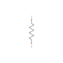 | Resistor (R) | 1, 2 | resistance: `1k`, `4.7k`, `{R}` | **R**, Parts › Passives |
| 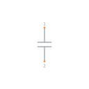 | Capacitor (C) | 1, 2 | capacitance: `1u`, `100n` | **C**, Parts › Passives |
| 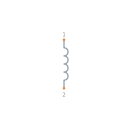 | Inductor (L) | 1, 2 | inductance: `1m`, `10u` | **L**, Parts › Passives |
| 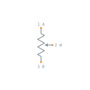 | Potentiometer (RV, netlisted as X) | A, W (wiper), B | `R=10k pos=0.5`: end-to-end resistance and wiper position from B (0) to A (1) | Parts › Passives › POT only |
| 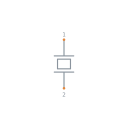 | Crystal (Y, netlisted as X) | 1, 2 | `F=10meg`, optionally `Cm= R= C0=` (defaults 25f, 10 Ω, 5p). A series RLC (resonant at F) with C0 across it | Parts › Passives › XTAL only |
| 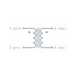 | Transformer (XF) | pri+, pri−, sec+, sec− | `Lp=1m Ls=100u k=0.999`: primary and secondary inductance and coupling (0 < k ≤ 1). Turns ratio is √(Lp/Ls) | Parts › Passives › XFMR |
|  | Mutual coupling (K) | none | `L1 L2 0.99`: two inductors on the sheet and their coupling | Parts › Passives › K |
| 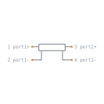 | Lossless transmission line (T) | port1+, port1−, port2+, port2− | `Z0=50 TD=1n` (or `Z0=50 F=… NL=…`) | Parts › Passives › T |

The pot and the crystal are small subcircuits from the built-in library. Place them from the Parts panel; a pot or crystal without its library entry stops the netlist with an error.

The transformer is netlisted as two inductors and a coupling line: a transformer named XF1 becomes `LXF1_P`, `LXF1_S` and `KXF1`. The dots on the symbol mark pri+ and sec+: current flowing into pri+ induces a voltage that makes sec+ positive.

## Sources

| Symbol | Part (prefix) | Pins in order | Value | Where to find it |
|---|---|---|---|---|
| 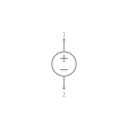 | Voltage source (V) | +, − | `DC 5`, `DC 0 AC 1 SIN(0 1 1k)`… (use **Waveform…**, [chapter 2](02-drawing-schematics.md#the-source-waveform-editor)) | **V**, Parts › Sources |
| 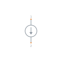 | Current source (I) | 1, 2 | `DC 1m`, waveforms as for V. Positive current flows from pin 1 through the source to pin 2 (the arrow) | **I**, Parts › Sources |
|  | Power flag | 1 | the net name, `VCC` by default | toolbar, Parts › Sources › VCC |
|  | Ground | 1 | none: net `0` | **G**, toolbar |
| 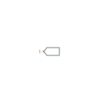 | Net label | 1 | the net name | **N**, toolbar |
| 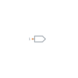 | Sheet port | 1 | the port name ([chapter 7](07-projects-and-hierarchy.md)) | **H**, toolbar |

## Controlled sources

| Symbol | Part (prefix) | Pins in order | Value | Where to find it |
|---|---|---|---|---|
| 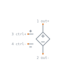 | Voltage-controlled voltage source (E) | out+, out−, ctrl+, ctrl− | gain: `10` gives V(out+, out−) = 10 × V(ctrl+, ctrl−) | Parts › Controlled sources › E |
| 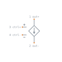 | Voltage-controlled current source (G) | out+, out−, ctrl+, ctrl− | transconductance in siemens: `1m` gives 1 mA per volt, flowing from out+ through the source to out− | Parts › Controlled sources › G |
| 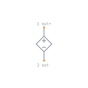 | Current-controlled voltage source (H) | out+, out− | `V1 1k`: the **name of a voltage source** whose current is sensed, then the transresistance in ohms | Parts › Controlled sources › H |
| 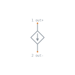 | Current-controlled current source (F) | out+, out− | `V1 10`: the **name of a voltage source**, then the current gain | Parts › Controlled sources › F |
| 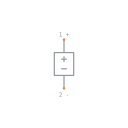 | Behavioural voltage source (B) | +, − | `V=<expression>`, e.g. `V=V(a)*V(b)` or `V=2*sin(6.283*1k*time)` | Parts › Controlled sources › BV |
| 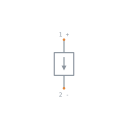 | Behavioural current source (B) | +, − | `I=<expression>`, e.g. `I=V(in)/1k` | Parts › Controlled sources › BI |
| 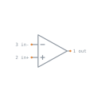 | Ideal op-amp (E) | out, in+, in− | open-loop gain, `1e6` by default. It is an E source with its output referred to ground, so it needs no supply pins and never clips | **Place › Op-amp** |

F and H measure the current through a **voltage source**, because that is how SPICE senses current. To sense the current in a wire, put a `DC 0` voltage source in series with it (an ammeter) and name that source in the value. If the named source isn't on the same sheet, the netlist shows a warning.

For B sources, a value without `V=` or `I=` gets the right prefix added.

## Switches

| Symbol | Part (prefix) | Pins in order | Value | Where to find it |
|---|---|---|---|---|
| 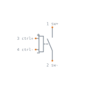 | Voltage-controlled switch (S) | sw+, sw−, ctrl+, ctrl− | a model name. The default `SW` is on (1 Ω) when V(ctrl) > 0.5 V and off (1 MΩ) otherwise | Parts › Switches › S |
| 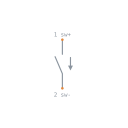 | Current-controlled switch (W) | sw+, sw− | `V1 CSW`: a voltage source whose current controls the switch, then a model name. The default `CSW` turns on above 1 mA | Parts › Switches › W |

To change the switching point or the on/off resistance, write your own model in a directive and use its name, for example `.model MYSW SW(ron=0.1 roff=10meg vt=2.5 vh=0.1)`.

## Semiconductors

| Symbol | Part (prefix) | Pins in order | Value | Where to find it |
|---|---|---|---|---|
| 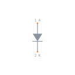 | Diode (D) | A (anode), K (cathode) | a model name: a library part such as `1N4148`, or `D` for a default diode | **D**, Parts › Diodes |
| 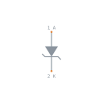 | Zener diode (D) | A, K | a model name (library Zeners such as `BZX55C5V6`) | Parts › Diodes |
| 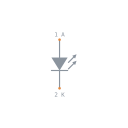 | LED (D) | A, K | a model name (`LED_RED`, `LED_GREEN`…) | Parts › Diodes |
| 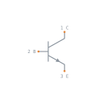 | NPN transistor (Q) | C, B, E | a model name (`2N3904`…), or `NPN` for a default | **Q**, Parts › BJTs |
| 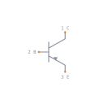 | PNP transistor (Q) | C, B, E | a model name (`2N3906`…), or `PNP` | **Place › PNP Transistor**, Parts › BJTs |
| 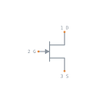 | N-channel JFET (J) | D, G, S | a model name, or `NJF` | Parts › JFETs |
| 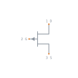 | P-channel JFET (J) | D, G, S | a model name, or `PJF` | Parts › JFETs |
| 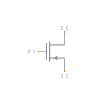 | NMOS transistor (M) | D, G, S (body tied to S) | a model name, or `NMOS` (a simple level-1 model) | **M**, Parts › MOSFETs |
| 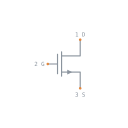 | PMOS transistor (M) | D, G, S (body tied to S) | a model name, or `PMOS` | **Place › PMOS Transistor**, Parts › MOSFETs |
| 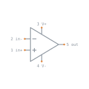 | Op-amp macromodel (X) | in+, in−, V+, V−, out | the subcircuit name, e.g. `OA_GENERIC` | Parts › Op-amps |

If the value is one of the default names (`D`, `DZ`, `LED`, `NPN`, `PNP`, `NJF`, `PJF`, `NMOS`, `PMOS`, `SW`, `CSW`), the app adds a basic `.model` for it. Your own `.model` line with the same name wins. Parts placed from the library bring their own model text.

Parts from a library carry more than a value: placing `2N3904` from the Parts panel links the part to its library entry, so the right model goes into the netlist. Typing `2N3904` into the value of a plain NPN does not; ngspice will then report that it can't find the model, unless you add the model yourself with `.model` or `.include`.

## Digital parts

The **Digital** category of the Parts panel has logic gates and a flip-flop. They simulate with ngspice's XSPICE digital models, and each part converts between analog and digital at its pins. You can wire them to each other, to sources and to analog parts like any other part, and every net plots as a voltage.

| Part | Pins in order | Netlisted as |
|---|---|---|
| AND2, NAND2, OR2, NOR2, XOR2 | A, B, Y | `X… a b y NAND2 params: vdd=5 tpd=10n` |
| INV, BUF | A, Y | an inverter or buffer |
| DFF | D, CLK, Q, Q̄ | a D flip-flop, rising-edge clock, Q = 0 at the start |

The value sets the logic family: `vdd=<logic high>` (output levels 0 and vdd, inputs switch at vdd/2) and `tpd=<delay>` (input to output; outputs then take 1 ns to swing). For 3.3 V logic, use `vdd=3.3`. For a clock, use a voltage source with a pulse, such as `PULSE(0 5 0 2n 2n 0.5u 1u)` for 1 MHz.

Inputs draw no current, and an unconnected input reads as low. An output is an ideal voltage source, so don't connect two outputs together. The project template **Digital counter (mixed-signal)** and the [Digital-Counter](examples/Digital-Counter/) example show a 2-bit counter made from two DFFs, an XOR gate and an RC filter.

## Blocks

A **block** is another sheet of the project used as one part; its pins are that sheet's ports. See [chapter 7](07-projects-and-hierarchy.md).

## Worked example: an E-source amplifier

[examples/E-Amplifier](examples/E-Amplifier/) amplifies a 0.1 V, 1 kHz sine by 10.

1. V1 is `DC 0 SIN(0 0.1 1k)`. Its top is labelled `in`.
2. E1 (Parts › Controlled sources › E) has ctrl+ wired to `in` and ctrl− to ground.
3. E1's out− goes to ground and out+ drives a 1 kΩ load labelled `out`.
4. E1's value is `10`, the gain.
5. The directive is `.tran 10u 3m`.

Run it: V(out) is a 1 V sine in phase with V(in). The netlist line is `E1 out 0 in 0 10`: out+, out−, ctrl+, ctrl−, gain.

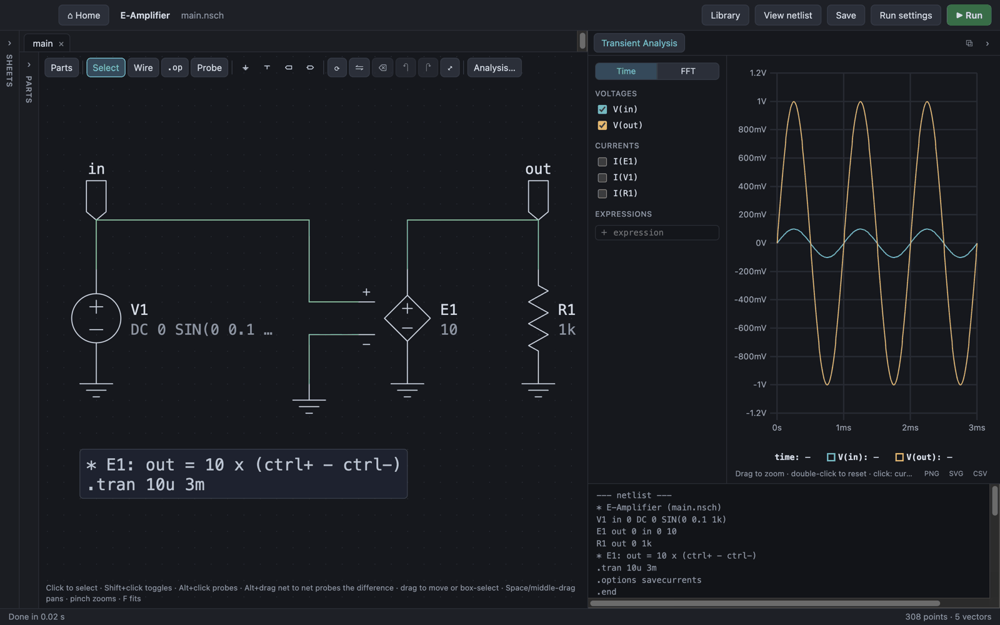

To turn E1 into an op-amp, give it a large gain (say `1e5`) and connect ctrl− to a feedback divider from `out` instead of to ground. The **Place › Op-amp** part is the same thing with its pins arranged as an op-amp.

## Worked example: a transformer in a flyback converter

[examples/Flyback](examples/Flyback/) steps 12 V up through a 1:2 transformer.

1. XF1 (Parts › Passives › XFMR) has the value `Lp=100u Ls=400u k=0.98`. The turns ratio is √(400µ/100µ) = 2.
2. The primary dot (pri+) goes to the 12 V supply V1; pri− goes to the switch node `sw`.
3. S1 (Parts › Switches › S) switches `sw` to ground. Its control is V2, `PULSE(0 1 0 10n 10n 5u 10u)`: 100 kHz, 50 % duty, above the default 0.5 V threshold for half of each period.
4. C2 (10 nF) from `sw` to ground is a snubber. Without it, the energy in the leakage inductance (k < 1) has nowhere to go when the switch opens, and the switch voltage spikes to many kilovolts.
5. The secondary dot (sec+) is grounded and sec− feeds D1 (a 1N4148 from the library), so energy reaches the output only while the switch is off. That is what makes it a flyback.
6. C1 (10 µF) and R1 (1 kΩ) are the output filter and load.
7. The directive card holds `.tran 100n 2m` and `.meas tran vout AVG v(out) from=1.5m to=2m`.

After a run, the **Measurements** tab shows `vout` ≈ 30 V. The plot below is zoomed to 1.8–1.9 ms and shows V(out) and the switch node V(sw):

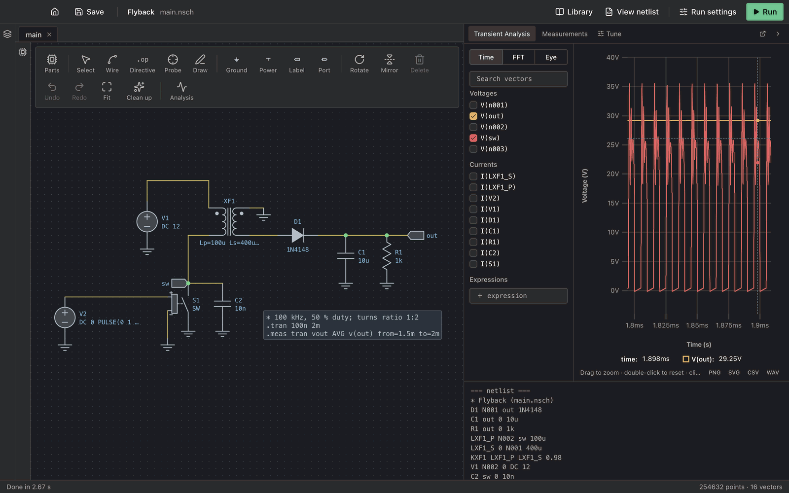

Next: [Simulating](04-simulating.md).
