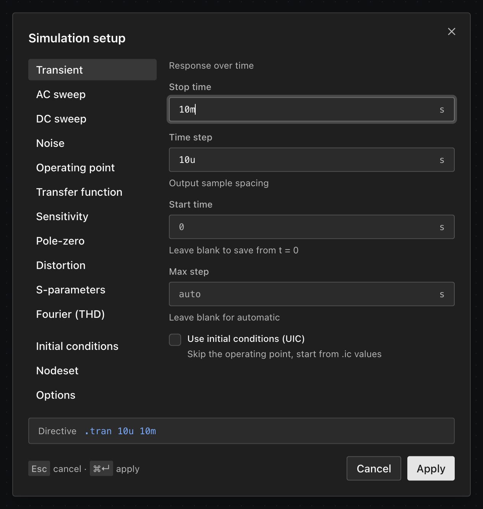
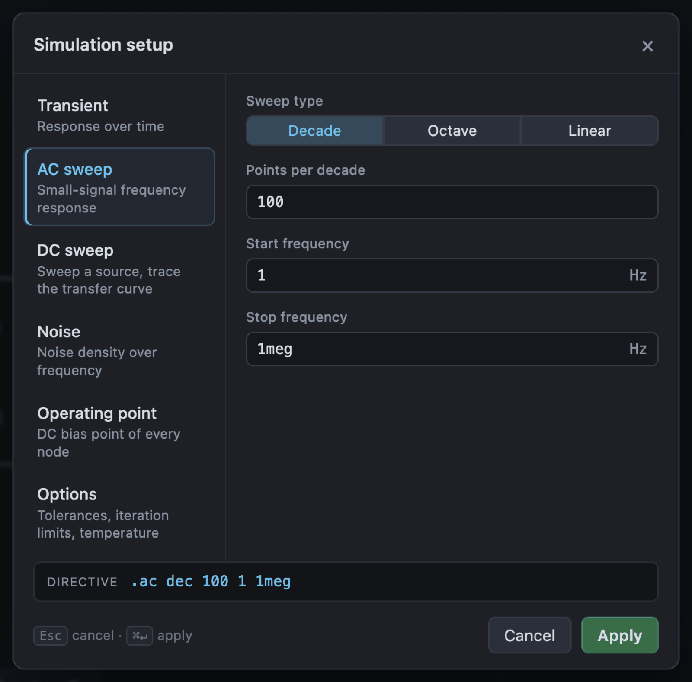
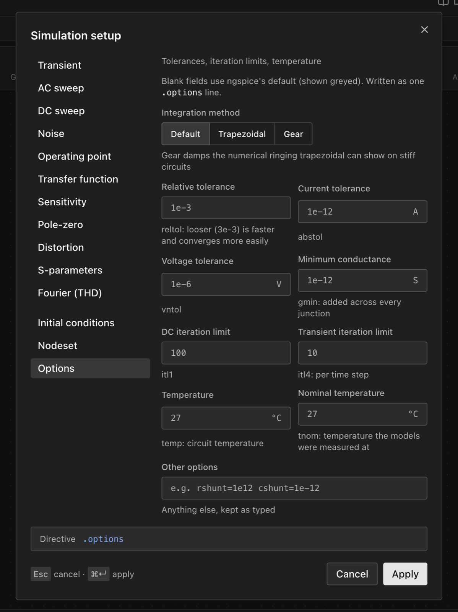
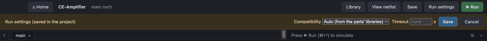
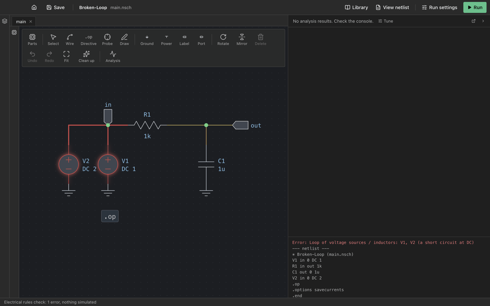
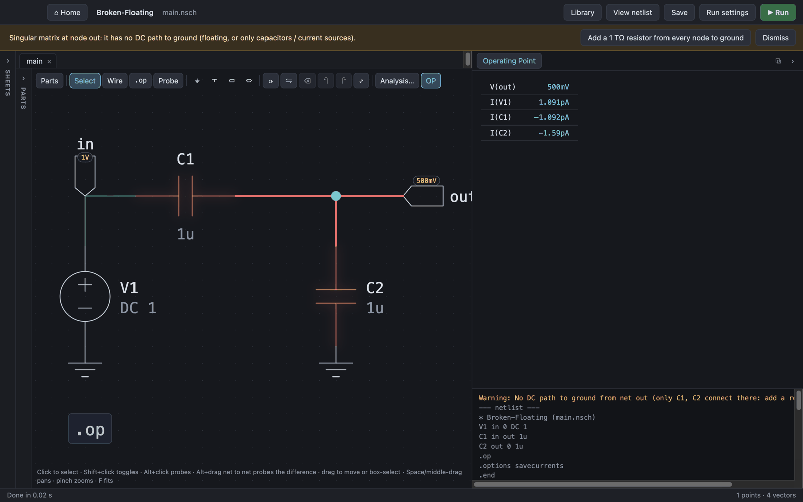

# 4. Simulating

[Guide index](README.md) · Previous: [Component reference](03-components.md) · Next: [Reading results](05-results.md)

A simulation needs at least one **analysis directive** on the sheet: `.op`, `.tran`, `.ac`, `.dc`, `.noise`, `.tf`, `.sens`, `.pz`, `.disto` or `.sp`. You can type them into a directive card ([chapter 2](02-drawing-schematics.md#spice-directives)) or build them in the Simulation setup dialog.

## The Simulation setup dialog

Open it with **A**, the **Analysis** toolbar button, or **Simulate › Analysis Setup…**.

Pick an analysis on the left and fill in its fields. Invalid fields turn red with a message, and the **Directive** line at the bottom shows exactly what will be written. **Apply** (or ⌘↵) writes it; **Esc** cancels.

Where the line goes:

- Opened from the toolbar, the menu or **A**, **Apply adds a new card** below the drawing, even if a card is selected.
- To change an existing analysis, select its card and click **Edit as analysis…** in the inspector. The dialog opens on that analysis and **Apply replaces the card's text**.

| Tab | Directive | Fields |
|---|---|---|
| Transient | `.tran step stop [start [maxstep]] [uic]` | **Stop time**, **Time step** (output spacing), optional **Start time** (save from this time), optional **Max step** (largest internal step), **Use initial conditions (UIC)** (skip the operating point and start from `.ic` values) |
| AC sweep | `.ac dec\|oct\|lin points fstart fstop` | **Sweep type** (Decade, Octave, Linear), points per decade/octave or total points, **Start frequency**, **Stop frequency**. Needs an `AC` magnitude on a source |
| DC sweep | `.dc source start stop increment [source2 start2 stop2 increment2]` | **Source** (a V or I source on the sheet), **Start value**, **Stop value**, **Increment**, and an optional **Second source** with its own start, stop and increment for a family of curves |
| Noise | `.noise v(out[,ref]) source dec\|oct\|lin points fstart fstop` | **Output node**, **Reference node** (ground by default), **Input source**, then the frequency sweep |
| Operating point | `.op` | none. Solves the DC bias with capacitors open and inductors shorted |
| Transfer function | `.tf v(out[,ref]) source` or `.tf i(Vx) source` | **Output** (a node voltage, or the current through a voltage source), **Input source** |
| Sensitivity | `.sens v(out[,ref])` or `.sens v(out) ac dec\|oct\|lin points fstart fstop` | **Output**, **Analysis** (DC, or AC with a frequency sweep) |
| Pole-zero | `.pz in inref out outref vol\|cur pz\|pol\|zer` | **Input node** and reference, **Output node** and reference, **Transfer function** (V(out)/V(in) or V(out)/I(in)), **Find** (poles and zeros, poles, zeros) |
| Distortion | `.disto dec\|oct\|lin points fstart fstop [f2/f1]` | The frequency sweep, optional **F2/F1 ratio** (0 to 1) for intermodulation |
| S-parameters | `.sp dec\|oct\|lin points fstart fstop [1]` | The frequency sweep, **Noise correlation** (writes the `1`) |
| Fourier (THD) | `.four freq v(out) …` | **Fundamental frequency**, **Outputs** (click the nets to analyse) |

A sheet can hold several analyses; each gives its own results tab. If the sheet has no analysis at all, the netlist warns that ngspice has nothing to run.

### Notes on the less common analyses

- **Transfer function** (`.tf`) works on the DC operating point: you get the small-signal gain from the input source to the output, the resistance the source sees and the resistance at the output, as a table.
- **Sensitivity** (`.sens`) tells you how much the output moves for a unit change of every part value and model parameter. DC sensitivity is a table, largest first; AC sensitivity is plotted against frequency. ngspice stops with an internal error on `.sens` when the circuit has `.sp` port sources, so keep the two in separate projects.
- **Pole-zero** (`.pz`) lists the poles and zeros of the transfer function between the two node pairs, in rad/s, with the natural frequency and Q. Not every circuit has finite zeros; an RC low-pass, for example, has only a pole.
- **Distortion** (`.disto`) needs `DISTOF1` on the input source value, and `DISTOF2` as well if you set an F2/F1 ratio, for example `DC 0 AC 1 DISTOF1 0.1 DISTOF2 0.1`. Without them every result is 0. You get one tab per harmonic (2nd, 3rd) or, with a ratio, per intermodulation product.
- **S-parameters** (`.sp`) needs one voltage source per port with `portnum` and `z0` in its value, for example `dc 0 ac 1 portnum 1 z0 50` and `dc 0 ac 0 portnum 2 z0 50`. Without a port ngspice stops with *No RF Port is present* (some ngspice 47 builds need at least two ports; the bundled engine accepts one). The results tab plots `S_1_1` to `S_2_2` by default; the Y and Z parameters are in the vector list.
- **Fourier** (`.four`) is not an analysis of its own: it analyses the `.tran` result over the last period of the fundamental, so the transient must run for at least one period. The dialog asks for a plain number as the frequency (a `{parameter}` doesn't reach the Fourier step) and for a `.tran` on the sheet. If the run is too short, ngspice's error shows in the console under `--- .four ---` (or `--- .meas ---`). The results go to the **Fourier** tab ([chapter 5](05-results.md#fourier-analysis-and-thd-four)). It shows 10 harmonics; add `nfreqs=20` under **Other options** for more.

## Simulation options (`.options`)

The **Options** tab (also **Simulate › Simulation Options…**, or **Edit options…** on an `.options` card) writes one `.options` line. Blank fields keep ngspice's default, shown in grey.

| Field | Option | Use it to |
|---|---|---|
| Integration method | `method=trap` / `method=gear` | Gear damps numerical ringing on stiff circuits |
| Relative tolerance | `reltol` (default 1e-3) | Loosen (e.g. 3e-3) for speed and easier convergence |
| Current tolerance | `abstol` (1e-12 A) | |
| Voltage tolerance | `vntol` (1e-6 V) | |
| Minimum conductance | `gmin` (1e-12 S) | Added across every junction; larger helps the DC solution |
| DC iteration limit | `itl1` (100) | More iterations for a hard operating point |
| Transient iteration limit | `itl4` (10) | More iterations per time step |
| Temperature | `temp` (27 °C) | Circuit temperature |
| Nominal temperature | `tnom` (27 °C) | Temperature the models were measured at |
| Other options | anything | Kept as typed, e.g. `rshunt=1e12 cshunt=1e-12` |

The sheet keeps one `.options` line: Apply replaces it (or adds a card if there is none).

## Initial conditions and nodesets (`.ic`, `.nodeset`)

The **Initial conditions** and **Nodeset** tabs (also **Simulate › Initial Conditions…**, or **Edit initial conditions…** / **Edit nodeset…** on a card that holds the line) write one `.ic` or `.nodeset` line. Each row is a net from the sheet and a voltage; **Add net** adds a row and **×** removes one.

- `.ic v(out)=2` sets node voltages at the start of a transient run. With **Use initial conditions (UIC)** on the `.tran`, they are the starting values. Without UIC, ngspice holds those nodes at the given voltages while it solves the operating point, then lets them go.
- `.nodeset v(q)=5` gives the operating-point solver a starting guess. Use it to choose the state of a flip-flop or latch, or to help a circuit that won't converge. The answer is still a real solution of the circuit.

As with `.options`, the sheet keeps one line of each: Apply replaces it, or adds a card if there is none. Entries the form can't show (such as `v(a,b)=1`) are kept as typed.

## Run and Stop

- **▶ Run** (top right), ⌘↵ or **Simulate › Run** starts a run. In a project, Run always simulates the **top sheet**, whichever sheet you are looking at.
- While it runs the button reads **■ Stop**. Click it, press ⌘. or choose **Simulate › Stop** to stop. During a sweep, the runs that finished are kept.

Each run is a separate ngspice process, so a crash or a hang can't take the app down. The status bar shows the progress (`Running 3/20 (run 3)…`) and then `Done in … s`, `Failed …`, `Stopped …` or `Timed out after … s`.

### Live results

You don't have to wait for a long run to finish. A few times a second the plots fill in with the points ngspice has computed so far, for transient, AC and DC sweeps, and the status bar shows how far the run has got (`Running… 45%`, from the analysis line's stop time or frequency). You can tick vectors, zoom and place cursors while it runs.

If you stop a run, or it times out, the points computed before that are kept in the plots, so you can stop a long transient as soon as you have seen enough.

**View netlist** in the header (or **Simulate › View Generated Netlist**) shows the netlist the app will send, without running it.

## Run settings

Click **Run settings** in the header. A bar opens under the header:

- **Compatibility** sets ngspice's compatibility mode for vendor models: **PSpice**, **LTspice**, **LTspice + PSpice** or **KiCad**. **Auto (from the parts' libraries)** uses whatever the libraries of the parts on your sheets declare, and nothing otherwise. Use it when models written for another simulator fail to parse ([chapter 8](08-libraries.md#compatibility-mode-for-pspice-and-ltspice-models)).
- **Timeout** stops any run that takes longer than this many seconds. Leave it blank for no limit.

Click **Save** to keep the settings. In a project they are stored in the `.nsproj` file, so they travel with it. New projects and single files start with the defaults from **Settings › New projects and files** ([chapter 1](01-getting-started.md#settings)).

## The electrical rules check

Before ngspice starts, the app checks the netlist. There are two levels.

**Errors stop the run** (status: `Electrical rules check: 1 error, nothing simulated`):

- A loop made only of voltage sources, E or H outputs and inductors, for example two voltage sources in parallel or an inductor straight across a source. At DC this is a short circuit.
- A voltage source, E/H output or inductor with both ends on the same net.

**Warnings let the run go ahead**:

- A net with no DC path to ground, for example a node joined only by capacitors or current sources. ngspice usually reports a singular matrix for these.

The parts and nets involved turn red on the schematic, and the message is the first line of the console. Click a red console line to select the parts it blames.

The netlister has its own checks that stop a run, such as *No ground*, *Empty schematic*, a part with no value, a duplicate name or a malformed transformer value. They show as `Error:` lines in the console with the status `Netlist errors (n)`.

## Convergence help

When ngspice fails in a way the app recognises, a yellow banner appears under the header with the problem in plain words and one or more fix buttons.

| Problem | Fix buttons (each adds to the top sheet's `.options` line) |
|---|---|
| Singular matrix at a node with no DC path to ground | **Add a 1 TΩ resistor from every node to ground** (`rshunt=1e12`) |
| Singular matrix at a voltage source or inductor branch | none: voltage sources or inductors form a loop, so the circuit has to change |
| No convergence in the DC operating point | **More iterations, finer source stepping** (`itl1=1000 srcsteps=100`), **More iterations, finer gmin stepping** (`itl1=1000 gminsteps=100`), **Larger minimum conductance** (`gmin=1e-10 itl1=500`) |
| Transient timestep too small | **Add 1 pF from every node to ground** (`cshunt=1e-12`), **Use Gear integration** (`method=gear`), **Loosen the tolerance, allow more iterations per step** (`reltol=3e-3 itl4=100`) |

Click a fix, then run again. **Dismiss** hides the banner. In the netlist editor the buttons copy the `.options` line to the clipboard instead. These options help ngspice through a hard spot; they don't fix a circuit that is wrong. [Chapter 10](10-troubleshooting.md) covers the underlying causes.

Next: [Reading results](05-results.md).
