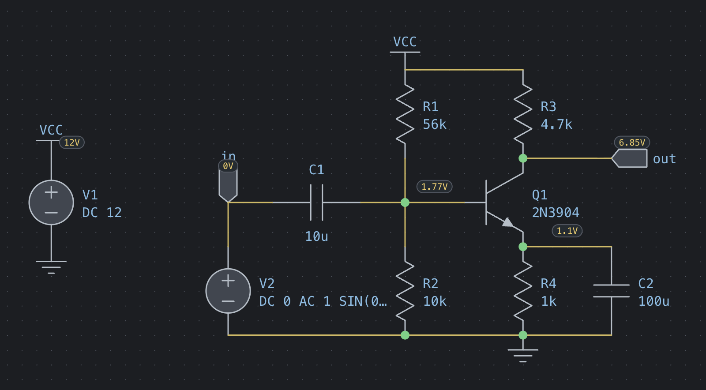

# 5. Reading results

[Guide index](README.md) · Previous: [Simulating](04-simulating.md) · Next: [Sweeps and Monte Carlo](06-sweeps.md)

The screenshots in this chapter use [examples/CE-Amplifier](examples/CE-Amplifier/), a 2N3904 common-emitter stage with `.op`, `.tran`, `.ac` and a `.meas` line.

## The results panel

After a run, the results panel on the right has:

- **Tabs**, one per analysis (*Operating Point*, *Transient Analysis*, *AC Analysis*, *DC transfer characteristic*, *Noise…*, *Transfer Function*, *Sensitivity Analysis*, *Pole-Zero Analysis*, *DISTORTION…*, *SP Analysis*) in the order of your analysis directives, plus **Measurements** when the deck has `.meas` lines and **Fourier** when it has `.four` lines. The first tab is shown after a run.
- **The vector list** on the left of the plot: **Voltages**, **Currents** and **Expressions**. Tick a box to plot that vector. The first few voltages are ticked for you. **Search vectors** at the top filters the list by name (`ecg`, `i(d1)`, `x3`); **Enter** ticks the first match, **Esc** clears the search.
- **The plot.** Voltages and currents get separate, titled y axes (currents on the right), so a milliamp trace isn't flattened next to a 10 V one. The legend under it names each trace and shows its value under the mouse.
- **The console** under the plot: the netlist that was run and ngspice's output.

Plot controls:

- Drag across the plot to zoom; drag mostly sideways to zoom in time only. Double-click to zoom back out.
- AC plots have **Magnitude** (dB) and **Phase** (degrees) buttons and a log-frequency axis.
- Transient plots have **Time** and **FFT** buttons (see below).
- The legend under the plot shows the values under the mouse.

An analysis that produces a single point, such as `.op`, is shown as a table instead of a plot.

### Tables for `.tf`, `.sens` and `.pz`

These results are numbers rather than waveforms, so their tabs show a table in place of the plot. With a sweep there is one column per run (for `.pz`, a **Run** column).

- **Transfer Function**: the gain (output over input source; no unit for V/V or A/A, Ω or S when the kinds differ), the input resistance at the source and the output resistance. A capacitor-coupled input shows a huge input resistance (such as `1e+20 Ω`): at DC the input is open.
- **Sensitivity Analysis** (DC): one row per part value or model parameter that moves the output, largest first. `r1` is the change per ohm of R1, `r1_m` the change per unit of its multiplier `m`. Parameters with no effect are left out. An AC sensitivity (`.sens … ac …`) is plotted against frequency instead; at a single frequency (`ac lin 1 1k 1k`) it is a table of magnitude ∠ phase.
- **Pole-Zero Analysis**: each pole and zero with its real and imaginary parts in rad/s, its natural frequency f = |s|/2π and, for a complex pair, Q.

### A DC sweep with two sources

`.dc V1 0 5 0.05 V2 0 2 0.5` sweeps V1 for each value of V2. The plot shows a family of curves, one per V2 value, shaded light to dark like a [sweep](06-sweeps.md); the legend names each one (`V(out) · V2=500m`). Set it up with **Second source** on the DC sweep tab ([chapter 4](04-simulating.md#the-simulation-setup-dialog)).

### Choosing the plots with `.plot`

Put `.plot` lines in a directive to pick what is plotted after each run. Each line becomes its own chart, stacked in the analysis's tab, so signals of very different sizes (millivolts at the electrodes, volts after the amplifier) each get a readable scale:

```
.plot tran v(la,ra) ; Electrodes
.plot tran v(ina) v(ecg) ; Amplified
.plot tran I(D1) v(led_a,led_k) ; LED current and voltage
```

Text after `;` (a SPICE inline comment) becomes the chart's title. When the charts don't fit, the stack scrolls.

The word after `.plot` names the analysis (`tran`, `ac`, `dc` or `noise`). An entry can be a vector name or any [expression](#expressions), written without spaces. Each chart keeps its own vector list, so you can tick more traces into it, and Alt+click probes go into the top chart. ngspice ignores `.plot` lines when it writes results for the app, so they don't change the simulation. The [ECG-Frontend](examples/ECG-Frontend/) example uses four.

## Probing the schematic

You can add traces straight from the schematic after a run. Probing works on the top sheet, which is the circuit that was simulated.

- **Alt+click a wire, label or pin** to add that net's voltage to the current tab.
- **Alt+click a part** to add the current through it (for a transistor, the collector or drain current).
- Alt+click the same thing again to remove its trace.
- Or press **P** (or click **Probe**) to use the probe tool, where a plain click probes. **Esc** goes back to Select.

While Alt is held, the net or part under the mouse is highlighted.


**Differential voltage.** Alt+drag from one net to another (a dashed line follows the mouse) and release on the second net. The app adds the expression `v(first)-v(second)`. Dragging to or from ground gives the plain voltage of the other net.


The status bar confirms each probe (`Added V(out)`, `Added v(vcc)-v(out)`), or says why nothing was added, for example `Run a simulation first` or `Ground is the 0 V reference`.

## The operating point on the schematic

If the deck includes `.op`, every named or wired net gets a small yellow tag with its DC voltage after the run. The **OP** toolbar button (or **View › Show Operating Point**) hides and shows them. The tags disappear when you edit the sheet, because they would be out of date.



The **Operating Point** tab lists the node voltages and device currents as a table:


## Cursors

1. Click on the plot to place cursor **A**.
2. **Shift+click** to place cursor **B**.
3. Drag a cursor line to move it.

A readout table appears under the plot. For each trace it shows the value at A, at B, the difference **B − A** and the **slope** (ΔY/ΔX). The first row shows the x values, their difference, and **1/Δ**, which is the frequency when A and B are one period apart. Click **×** in the table to remove both cursors.


Cursors stay where they are when you switch tabs or pop the plot out, until the next run.

## Expressions

Type a formula into **＋ expression** under the vector list and press **Enter**. It is plotted like any other trace and kept across runs. Click **×** to remove it. A formula with a mistake shows the error in red under the box.

| You can use | Example |
|---|---|
| Any vector by its raw or display name | `v(out)`, `i(r3)`, `ic(q1)` |
| Differential voltage | `v(a,b)` is the same as `v(a)-v(b)` |
| Arithmetic with `+ − * /` and brackets | `(v(vcc)-v(out))/4.7k` |
| SPICE numbers | `1k`, `2.2u` |
| `db(x)` | gain in dB: `db(v(out)/v(in))` |
| `mag(x)`, `abs(x)` | magnitude |
| `ph(x)` | phase in degrees |
| `re(x)`, `im(x)` | real and imaginary parts (AC) |
| `sqrt(x)` | square root |
| `deriv(x)` | derivative with respect to the x axis, e.g. `deriv(v(out))` in V/s |
| `gd(x)` | group delay of an AC result, in seconds |

Units follow the maths: volts times amps is watts, so `v(out)*i(r1)` or `(v(vcc)-v(out))*i(r3)` is plotted as power in W on its own axis. In AC results, expressions work on complex values, so `db(v(out)/v(in))` is the true gain.

## FFT

On a transient tab, click **FFT** to see the spectrum of the ticked traces.

1. Optional: place cursors A and B first. The FFT then uses only the time between them; for a clean spectrum, span a whole number of periods after the circuit has settled.
2. Click **FFT**. **Log f** and **Linear f** switch the frequency axis.
3. Click **Time** to go back.

The hint line under the plot shows the settings: a Hann window, the number of points N (a power of two, up to 65,536) and the bin spacing Δf. ngspice's time steps are uneven, so the app resamples the waveform first; for an accurate spectrum, set a small **Max step** in the `.tran` line.


## Measurements (`.meas`)

A `.meas` directive makes ngspice compute a single number from a result, such as a peak-to-peak value, a rise time or an average. The CE-Amplifier example has

```
.meas tran vpp PP v(out) from=2m to=5m
```

After a run, the **Measurements** tab lists each measurement by name. A measurement that failed (for example, a `WHEN` condition that never happens) shows **failed**; hover over it to see ngspice's message.


Some useful forms:

```
.meas tran vavg AVG v(out) from=1m to=2m
.meas tran vmax MAX v(out)
.meas tran trise TRIG v(out) VAL=0.1 RISE=1 TARG v(out) VAL=0.9 RISE=1
.meas tran t50 WHEN v(out)=0.5 RISE=1
.meas ac fpeak WHEN vdb(out)=-3 FALL=1
```

Each measurement is read from its own analysis, so `.meas tran`, `.meas ac` and `.meas dc` lines can share a deck with each other and with `.tf`, `.sens`, `.pz` or `.disto`. One exception: when a measured analysis line uses a `{parameter}` or a quoted expression (such as `.tran 10u {tstop}` or `.tran 10u 'tstop'`), ngspice reports only one analysis type's measurements. Write that line with plain numbers if you need both.

With a sweep or Monte Carlo run there is one column per run, plus **mean**, **σ**, **min** and **max** when there are more than two runs ([chapter 6](06-sweeps.md)).

## Fourier analysis and THD (`.four`)

`.four 1k v(out) v(in)` makes ngspice analyse the transient result at a 1 kHz fundamental, over its last period. After a run, the **Fourier** tab has one table per output: for each harmonic its frequency, magnitude, phase, and the magnitude and phase relative to the fundamental. The heading shows the total harmonic distortion (THD).

The transient must cover at least one period of the fundamental. For a clean spectrum, let the circuit settle first (a longer stop time) and set a small **Max step** on the `.tran`. With a sweep there is one table per output and run.

## The pop-out window

Click **⧉** at the top right of the results panel (or **View › Results in Separate Window**) to move the results into their own window. You can put it on a second screen and make it as large as you like. It stays live: new runs, probes and expressions appear there. Click **Dock** (or close the window) to bring the results back.

While the results are popped out, the right edge of the main window shows a **Results** rail; a dot on it means new results arrived. ⌘3 shows or hides the docked results panel.

Next: [Sweeps and Monte Carlo](06-sweeps.md).
