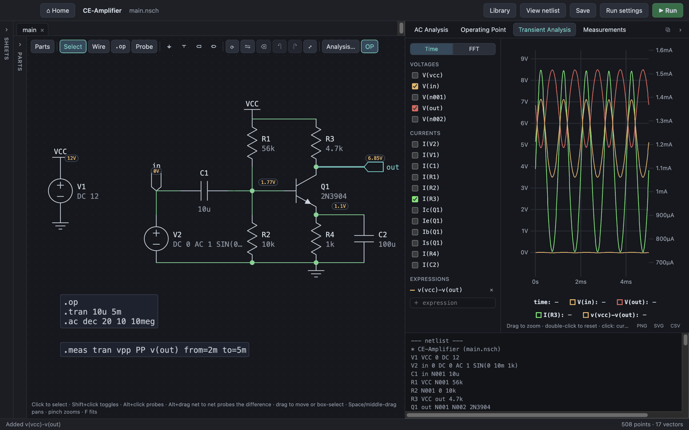
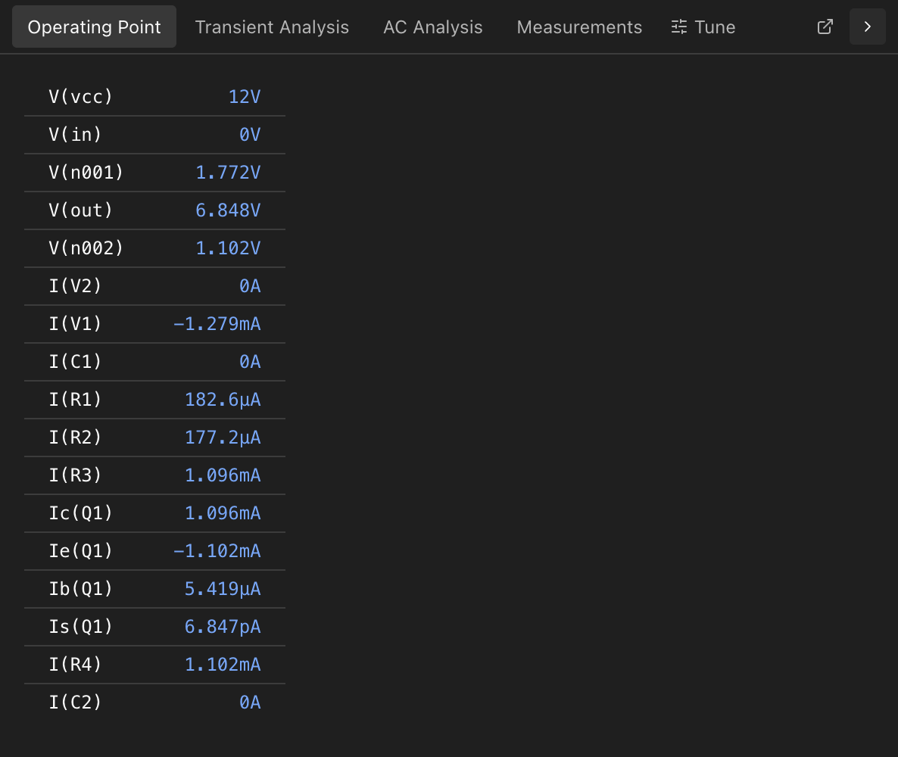
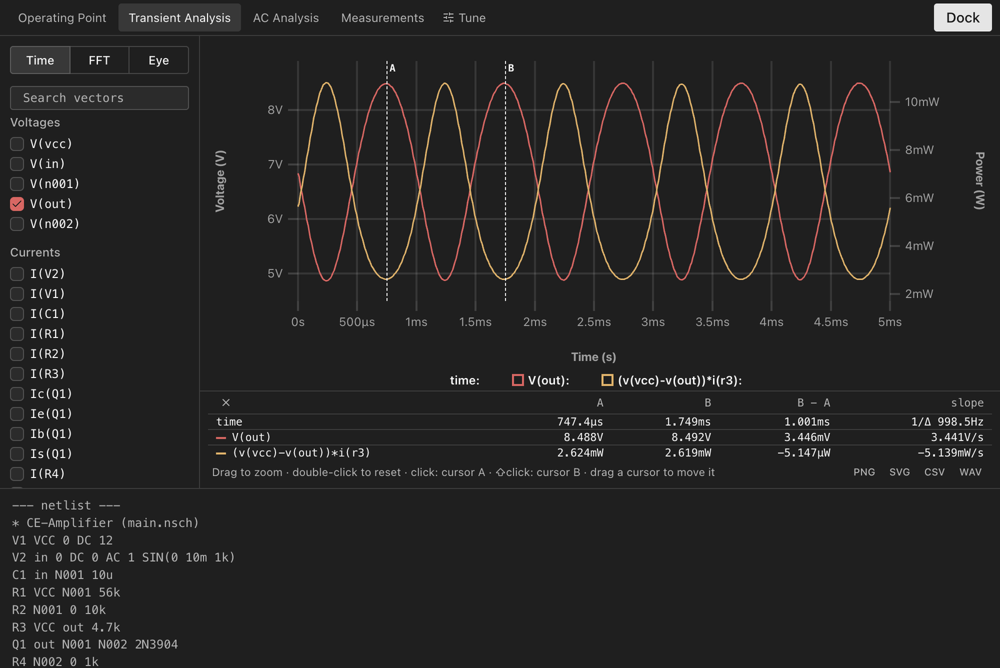

# 5. Reading results

[Guide index](README.md) · Previous: [Simulating](04-simulating.md) · Next: [Sweeps and Monte Carlo](06-sweeps.md)

The screenshots in this chapter use [examples/CE-Amplifier](examples/CE-Amplifier/), a 2N3904 common-emitter stage with `.op`, `.tran`, `.ac` and a `.meas` line.

## The results panel

After a run, the results panel on the right has the following parts:

- **Tabs**, one per analysis (*Operating Point*, *Transient Analysis*, *AC Analysis*, *DC transfer characteristic*, *Noise…*, *Transfer Function*, *Sensitivity Analysis*, *Pole-Zero Analysis*, *DISTORTION…*, *SP Analysis*) in the order of your analysis directives, plus **Measurements** when the deck has `.meas` lines and **Fourier** when it has `.four` lines. The first tab is shown after a run.
- **The vector list** on the left of the plot: **Voltages**, **Currents** and **Expressions**. Tick a box to plot that vector. The first few voltages are ticked for you. **Search vectors** at the top filters the list by name (`ecg`, `i(d1)`, `x3`); **Enter** ticks the first match, **Esc** clears the search.
- **The plot.** Voltages and currents get separate, titled y axes (currents on the right), so a milliamp trace isn't flattened next to a 10 V one. The legend under it names each trace and shows its value under the mouse.
- **The console** under the plot: the netlist that was run and ngspice's output.

The plot has the following controls:

- Drag across the plot to zoom. Drag mostly sideways to zoom in time only. Double-click to zoom back out.
- AC plots open in the **Bode** view: magnitude above phase on one log-frequency axis. **Magnitude** and **Phase** show one of them on its own. **Nyquist**, **Polar** and **Smith** draw the complex values (see [AC views](#ac-views-bode-nyquist-polar-smith)).
- Transient plots have **Time**, **FFT** and **Eye** buttons (see [FFT](#fft) and [Eye diagram](#eye-diagram)).

An analysis that produces a single point, such as `.op`, is shown as a table instead of a plot.

### Tables for `.tf`, `.sens` and `.pz`

These results are numbers rather than waveforms, so their tabs show a table in place of the plot. With a sweep there is one column per run (for `.pz`, a **Run** column). The tables hold the following:

- **Transfer Function**: the gain (output over input source; no unit for V/V or A/A, Ω or S when the kinds differ), the input resistance at the source and the output resistance. A capacitor-coupled input shows a huge input resistance (such as `1e+20 Ω`), because at DC the input is open.
- **Sensitivity Analysis** (DC): one row per part value or model parameter that moves the output, largest first. `r1` is the change per ohm of R1, `r1_m` the change per unit of its multiplier `m`. Parameters with no effect are left out. An AC sensitivity (`.sens … ac …`) is plotted against frequency instead. At a single frequency (`ac lin 1 1k 1k`) it is a table of magnitude ∠ phase.
- **Pole-Zero Analysis**: each pole and zero with its real and imaginary parts in rad/s, its natural frequency f = |s|/2π and, for a complex pair, Q.

### A DC sweep with two sources

`.dc V1 0 5 0.05 V2 0 2 0.5` sweeps V1 for each value of V2. The plot shows a family of curves, one per V2 value, shaded light to dark like a [sweep](06-sweeps.md), and the legend names each one (`V(out) · V2=500m`). Set it up with **Second source** on the DC sweep tab ([chapter 4](04-simulating.md#the-simulation-setup-dialog)).

### Opening a raw file

**File › Open Raw File…** shows the results in an existing `.raw` file without running anything. The file can be one written by ngspice (`ngspice -b -r out.raw`, `write` in a `.control` block, binary or ASCII) or by LTspice. Each plot in the file gets a tab, and the plot tools (cursors, expressions, FFT, export) work as usual. From the Home page it opens in an untitled workspace. In an open project it replaces the results panel's contents until the next run.

### Building plots

A tab starts with one plot. Build more in the tab as follows:

- **Add plot** in the bar above the plots adds another chart with its own vector list. With several plots, the bar also has **All plots** (every chart, stacked) and one button per plot (that chart on its own). The arrows at the top right of a plot do the same.
- Click the line above a plot (**Plot 1: click to add a title**) and type its title.
- In a project with blocks, the vector list has one group per sheet: **Top sheet**, then each block as `X1 · filter` (the instance and its sheet). Click a group to open it and tick what you want plotted. A closed group says how many of its vectors are plotted.
- The axes get their titles from what is plotted. To change one, or the name of a trace in the legend, open **Labels** at the bottom of the vector list, type the text and press **Enter**. Clear the box to go back to the automatic label.
- **×** removes a plot.

Plots, titles and labels are kept across runs until you close the project. Alt+click probes go into the plot shown on its own, or the top one when all are shown.

### Choosing the plots with `.plot`

Put `.plot` lines in a directive to pick what is plotted after each run. Each line becomes its own chart, stacked in the analysis's tab, so signals of very different sizes (millivolts at the electrodes, volts after the amplifier) each get a readable scale:

```
.plot tran v(la,ra) ; Electrodes
.plot tran v(ina) v(ecg) ; Amplified
.plot tran I(D1) v(led_a,led_k) ; LED current and voltage
```

Text after `;` (a SPICE inline comment) becomes the chart's title. When the charts don't fit, the stack scrolls.

The word after `.plot` names the analysis (`tran`, `ac`, `dc` or `noise`). An entry can be a vector name or any [expression](#expressions), written without spaces. Each chart keeps its own vector list, so you can tick more traces into it, and Alt+click probes go into the top chart. ngspice ignores `.plot` lines when it writes results for the app, so they don't change the simulation. The [ECG-Frontend](examples/ECG-Frontend/) example uses four.

## Probing the schematic

Probe the schematic to put small plots on it, each tied to the point it reads. It works on every sheet the top sheet uses ([inside a block's sheet](07-projects-and-hierarchy.md) the traces are that block's). Probe in the following ways:

- **Alt+click a wire, label or pin** to plot that net's voltage.
- **Alt+click a part** to plot the current through it (for a transistor, the collector or drain current).
- **Alt+drag from one net to another** to plot the difference between them.
- Press **P** (or click **Probe**) to use the probe tool, where a plain click probes. **Esc** goes back to Select.

While Alt is held, the net or part under the mouse is highlighted.

Each probe opens a plot beside the point, a compact version of the results panel's charts: drag across it to zoom, double-click to reset, and hover to read each value in the title bar. A dot marks the probed point and a line ties it to its plot. You can do the following with a plot:

- **Move it** by its title bar, and resize it from its bottom-right corner. Plots keep their place and size while you pan and zoom the schematic.
- **Move the probe point**: drag its dot onto another wire or part.
- **Add points**: click **＋** on the plot, then click more wires or parts. Press **Esc** when done. **×** beside a name takes that point off.
- **All / Δ**: with two or more points, **All** draws each as its own trace and **Δ** draws the first point minus each of the others.
- **Remove it** with **×**.

You can probe before running: the plot is empty until the next run fills it. The plots show the analysis tab you last looked at in the results panel, and update on every run. When there are results, a probed point is also ticked in the results panel's chart (the panel is not opened for you).


**Differential voltage.** Alt+drag from one net to another (a dashed line follows the mouse) and release on the second net. The app adds the expression `v(first)-v(second)`. Dragging to or from ground gives the plain voltage of the other net.



The status bar confirms each probe (`Added V(out)`, `Added v(vcc)-v(out)`), or says why nothing was added, for example `Run a simulation first` or `Ground is the 0 V reference`.

## The operating point on the schematic

If the deck includes `.op`, every named or wired net gets a small yellow tag with its DC voltage after the run. The **OP** toolbar button (or **View › Show Operating Point**) hides and shows them. The tags disappear when you edit the sheet, because they would be out of date.


The **Operating Point** tab lists the node voltages and device currents as a table:



## Cursors

To place cursors, do the following:

1. Move the mouse over the plot and press **A** to place cursor **A** there.
2. Press **B** to place cursor **B**.
3. Drag a cursor line to move it.

Right-click the plot for the same as a menu: **Place cursor A here**, **Place cursor B here**, **Remove cursor A** / **B** and **Reset zoom**.

A readout table appears under the plot. For each trace it shows the value at A, at B, the difference **B − A** and the **slope** (ΔY/ΔX). The first row shows the x values, their difference, and **1/Δ**, which is the frequency when A and B are one period apart. Click **×** in the table to remove both cursors, or right-click and choose **Remove cursor A** or **B** to remove one.



Cursors stay where they are when you switch tabs or pop the plot out, until the next run.

## Expressions

Type a formula into **＋ expression** under the vector list and press **Enter**. It is plotted like any other trace and kept across runs. Click **×** to remove it. A formula with a mistake shows the error in red under the box.

The following table lists what a formula can use:

| You can use | Example |
|---|---|
| Any vector by its raw or display name | `v(out)`, `i(r3)`, `ic(q1)` |
| Differential voltage | `v(a,b)` is the same as `v(a)-v(b)` |
| Arithmetic with `+ − * /` and brackets | `(v(vcc)-v(out))/4.7k` |
| SPICE numbers | `1k`, `2.2u` |
| `db(x)` | gain in dB: `db(v(out)/v(in))` |
| `mag(x)`, `abs(x)` | magnitude |
| `ph(x)` | phase in degrees |
| `re(x)`, `im(x)` | real and imaginary parts (AC) |
| `sqrt(x)` | square root |
| `deriv(x)` | derivative with respect to the x axis, for example `deriv(v(out))` in V/s |
| `gd(x)` | group delay of an AC result, in seconds |

Units follow the maths. Volts times amps is watts, so `v(out)*i(r1)` or `(v(vcc)-v(out))*i(r3)` is plotted as power in W on its own axis. In AC results, expressions work on complex values, so `db(v(out)/v(in))` is the true gain.

## Logic view

In a transient plot, the nets on [digital parts](03-components.md#digital-parts) are drawn as logic rows instead of voltages. Each ticked signal gets its own row in a chart under the analog traces: high when the voltage is above the part's threshold (vdd/2), low otherwise. The logic chart follows the same zoom and the same cursors as the analog chart, and the cursor table reads `0` or `1` for each row.

Clear **Logic rows** above the vector list to plot these nets as voltages again, for example to look at an edge.

To show several signals as one value, add a bus: type `bus(q1,q0)` into **＋ expression**, most significant bit first, and press **Enter**. The bus gets a row with its value written in each interval. **Bus: hex** and **Bus: decimal** switch how the value is written. A bus can use any voltage: a net that isn't on a digital part is split halfway between its lowest and highest value.

The logic view covers the nets of the top sheet. Nets inside a hierarchical block plot as voltages.

## AC views: Bode, Nyquist, polar, Smith

An AC tab has two rows of view buttons. The views are as follows:

- **Bode** (the default) stacks the magnitude in dB over the phase in degrees. The two charts share the frequency axis, so zooming one zooms the other, and cursors A and B show in both. One legend, under the phase chart, shows both values under the mouse (`-3.01dB · -45.0°`). The cursor readout lists each trace twice, once in dB and once in degrees.
- **Magnitude** and **Phase** show one chart on its own.
- **Unwrap phase** (Bode and Phase) removes the jumps from −180° to +180°, so a fourth-order filter's phase runs smoothly down to −360°.
- **Nyquist** plots Im against Re with equal scales, with −1 marked when it is in view.
- **Polar** draws the same points on a polar grid: magnitude rings and angle spokes.
- **Smith** draws reflection coefficients on a Smith chart. S-parameters (from a `.sp` analysis) are drawn as they are. A trace in ohms, such as the expression `v(in)/i(v1)` or a `Z_1_1` vector, is converted with Γ = (Z − Z0)/(Z + Z0); set **Z0** in the sidebar (50 Ω by default). Any other trace is drawn as if it were Γ. Parts of a trace outside |Γ| = 1 are cut off at the edge of the chart.

The Nyquist, polar and Smith views share the following behaviour:

- Hover over a trace to read its frequency and value in the top-right corner. The Smith chart also shows the impedance.
- Click a trace to put cursor A at that frequency, and Shift+click for cursor B. Dots mark each trace at A and B.
- In the Nyquist and polar views, scroll to zoom (Nyquist zooms about the mouse) and double-click to see everything again.
- All ticked traces share one scale, so a small trace next to a large one (a current next to a voltage) can shrink to a dot. Untick the large one or zoom in.
- Only complex traces are drawn. `db(…)` and other real expressions are left out.
- **PNG**, **SVG** and **CSV** export these views too. The CSV has the real and imaginary parts.

## Eye diagram

On a transient tab, click **Eye** to overlay a waveform period by period, as an oscilloscope eye diagram does. To set it up, do the following:

1. Pick the **Trace** (one of the ticked traces).
2. Type the **Bit period**, for example `1u`.
3. Optional: type an **Offset**. Periods start at offset + k × period, so an offset moves the eye sideways. Use it to centre the crossings.

Every whole period in the run is drawn over the others, up to 2,000. With more, the axis title says how many of them are shown (`the first 2000 of 5000 periods`). The app resamples the waveform at 256 points per period, so set a small **Max step** in the `.tran` line for sharp edges. Drag to zoom, double-click to zoom back out. PNG and SVG export the eye.

## Tuning values with sliders

**Tune** in the results tab bar opens a row of sliders above the plots. To tune a value, do the following:

1. Pick a value in **Add a parameter or part…**: a `.param` with a plain number, or a resistor, capacitor or inductor whose value is a number. Parameters a `.step` line sweeps aren't offered, since the sweep sets them.
2. Each slider covers a decade either side of the value on a log scale. Edit the minimum and maximum, or untick **log** for a linear scale.
3. Move the slider. The app runs the simulation again a moment after you stop moving it, and stops a run that is still going if you move it again.

The plot updates in place: the zoom, the cursors and the ticked traces stay as they are. Every run while the sliders are open uses the slider values, and the console starts with a `Tuned:` line listing them. The values aren't written back to the schematic.

To go back to the netlist values, do one of the following:

- Remove a slider (**×**) to go back to the netlist value for that slider.
- Close the row to go back to all the netlist values. The app runs the simulation once more with them, so the plot matches the schematic again.

The sliders, with their ranges, stay in use if you pop the results out or dock them. If you press **Stop** during a tuning run, the plot keeps the last run that finished.

## FFT

On a transient tab, click **FFT** to see the spectrum of the ticked traces. The full procedure is as follows:

1. Optional: place cursors A and B first. The FFT then uses only the time between them. For a clean spectrum, span a whole number of periods after the circuit has settled.
2. Click **FFT**. **Log f** and **Linear f** switch the frequency axis.
3. Click **Time** to go back.

The hint line under the plot shows the settings: a Hann window, the number of points N (a power of two, up to 65,536) and the bin spacing Δf. ngspice's time steps are uneven, so the app resamples the waveform first. For an accurate spectrum, set a small **Max step** in the `.tran` line.


## Measurements (`.meas`)

A `.meas` directive makes ngspice compute a single number from a result, such as a peak-to-peak value, a rise time or an average. The CE-Amplifier example has the following line:

```
.meas tran vpp PP v(out) from=2m to=5m
```

After a run, the **Measurements** tab lists each measurement by name. A measurement that failed (for example, a `WHEN` condition that never happens) shows **failed**. Hover over it to see ngspice's message.


The following forms are often useful:

```
.meas tran vavg AVG v(out) from=1m to=2m
.meas tran vmax MAX v(out)
.meas tran trise TRIG v(out) VAL=0.1 RISE=1 TARG v(out) VAL=0.9 RISE=1
.meas tran t50 WHEN v(out)=0.5 RISE=1
.meas ac fpeak WHEN vdb(out)=-3 FALL=1
```

Each measurement is read from its own analysis, so `.meas tran`, `.meas ac` and `.meas dc` lines can share a deck with each other and with `.tf`, `.sens`, `.pz` or `.disto`. One exception: when a measured analysis line uses a `{parameter}` or a quoted expression (such as `.tran 10u {tstop}` or `.tran 10u 'tstop'`), ngspice reports only one analysis type's measurements. Write that line with plain numbers if you need both.

With a sweep or Monte Carlo run there is one column per run, plus **mean**, **σ**, **min** and **max** when there are more than two runs ([chapter 6](06-sweeps.md)).

## Fourier analysis and THD (`.four`)

`.four 1k v(out) v(in)` makes ngspice analyse the transient result at a 1 kHz fundamental, over its last period. After a run, the **Fourier** tab has one table per output: for each harmonic its frequency, magnitude, phase, and the magnitude and phase relative to the fundamental. The heading shows the total harmonic distortion (THD).

The transient must cover at least one period of the fundamental. For a clean spectrum, let the circuit settle first (a longer stop time) and set a small **Max step** on the `.tran`. With a sweep there is one table per output and run.

## The pop-out window

Click **⧉** at the top right of the results panel (or **View › Results in Separate Window**) to move the results into their own window. You can put it on a second screen and make it as large as you like. It stays live, so new runs, probes and expressions appear there. Click **Dock** (or close the window) to bring the results back.

While the results are popped out, the right edge of the main window shows a **Results** rail. A dot on it means new results arrived. ⌘3 shows or hides the docked results panel.

Next: [Sweeps and Monte Carlo](06-sweeps.md).
