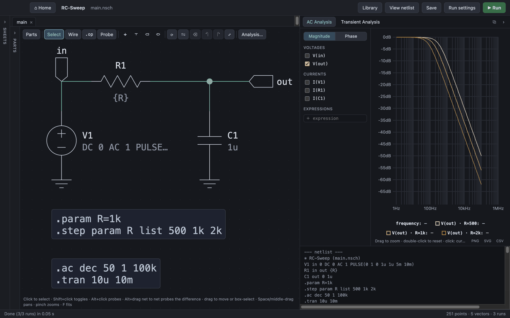
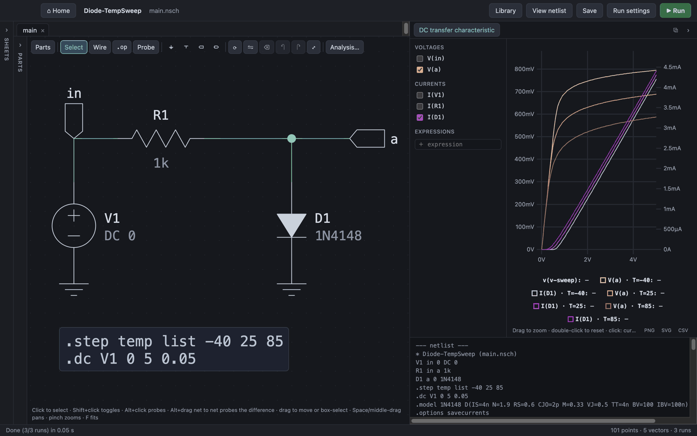
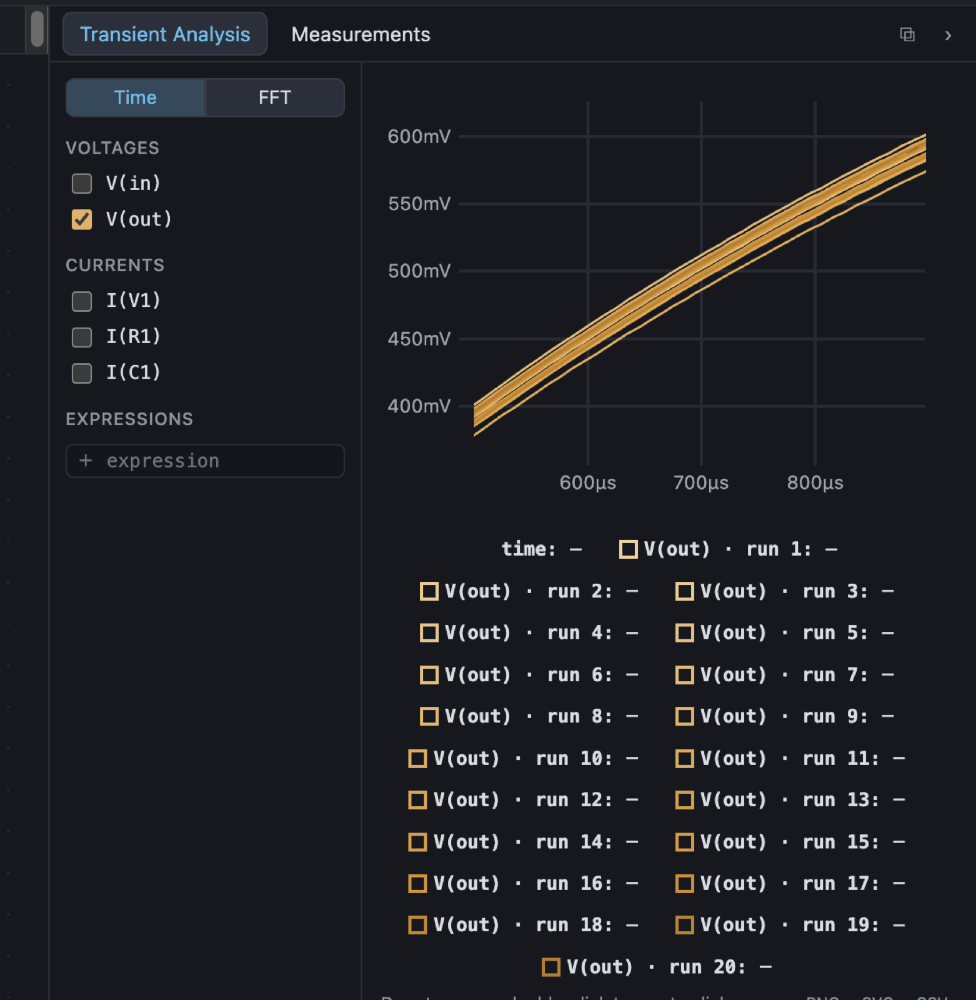
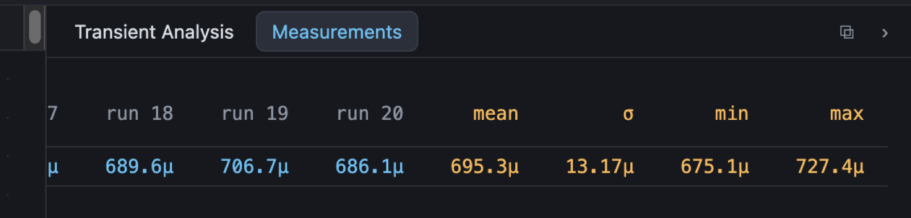

# 6. Sweeps and Monte Carlo

[Guide index](README.md) · Previous: [Reading results](05-results.md) · Next: [Projects and hierarchy](07-projects-and-hierarchy.md)

Spice Studio can run the same circuit several times with different values and overlay the results. Three directives do this: `.step param`, `.step temp` and `.mc`. The app expands them itself and runs ngspice once per value, so they work with any analysis.

In the plots, each run is drawn in the trace's colour, from light (first run) to dark (last run). The legend and the cursor readout name each run, for example `V(out) · R=1k`. The status bar shows how many runs finished.

Limits: at most 50 runs for `.step` (all nested steps together), at most three nested `.step` lines, and at most 500 runs for `.mc`.

## Parameter sweep: `.step param`

1. Give the part a parameter as its value, in braces: set R1's value to `{R}`.
2. Define the parameter's default: `.param R=1k`.
3. Add the sweep: `.step param R list 500 1k 2k`.
4. Run.

[examples/RC-Sweep](examples/RC-Sweep/) does exactly this on the RC filter. The AC tab shows three curves; the corner frequency moves down as R goes up:



The forms of `.step`:

| Directive | Values |
|---|---|
| `.step param R list 500 1k 2k` | the listed values |
| `.step param R 1k 5k 1k` | 1k to 5k in steps of 1k (linear) |
| `.step lin param R 1k 5k 1k` | the same |
| `.step dec param C 1n 1u 3` | 1 nF to 1 µF, 3 points per decade |
| `.step oct param F 1k 8k 1` | 1 kHz to 8 kHz, 1 point per octave |

You can step up to three parameters with separate `.step` lines. The first `.step` changes slowest. The parameter doesn't need a `.param` line; if there is none the app adds one, and if there is one the app replaces its value in each run, so expressions such as `{2*R}` follow along.

## Temperature sweep: `.step temp`

`.step temp` runs the circuit at several temperatures in °C, using the same forms as above:

```
.step temp list -40 25 85
.step temp -40 85 25
```

[examples/Diode-TempSweep](examples/Diode-TempSweep/) sweeps V1 from 0 to 5 V through 1 kΩ into a 1N4148 diode at −40, 25 and 85 °C:

```
.step temp list -40 25 85
.dc V1 0 5 0.05
```

The forward voltage V(a) falls as the diode warms up: at V1 = 5 V it is about 0.79 V at −40 °C, 0.69 V at 25 °C and 0.59 V at 85 °C, roughly −1.7 mV per °C. The hot curve (darkest) sits lowest:



Each run replaces any `.temp` line on the sheet with its own. A `temp=` setting in `.options` is overridden as well.

## Monte Carlo: `.mc`

`.mc N` runs the circuit N times. Each run uses a different random seed (run 1 uses seed 1, run 2 seed 2…), so values written with ngspice's random functions change from run to run, and the same project gives the same results each time with the same ngspice.

1. Give each toleranced part a parameter as its value, e.g. R1 = `{R}`.
2. Define the parameter with a random function (see the gotcha below).
3. Add `.mc 20` and an analysis.
4. Add a `.meas` line for the number you care about.
5. Run, then open the **Measurements** tab.

[examples/MonteCarlo-RC](examples/MonteCarlo-RC/) checks how a ±5 % resistor spreads the RC filter's delay:

```
* R1 = 1k ±5 % (3 sigma), relative
.param R={gauss(1k,0.05,3)}

.mc 20
.tran 10u 3m
.meas tran t50 WHEN v(out)=0.5 RISE=1
```

`t50` is the time V(out) first crosses 0.5 V after the step, R·C·ln 2 ≈ 693 µs for the nominal values.



The **Measurements** tab has one column per run and then the statistics over all runs: **mean**, **σ** (sample standard deviation), **min** and **max**. Scroll the table to the right to see them.



Here σ is about 13 µs, about 1.9 % of the mean. That matches a resistor with a 1.67 % standard deviation (5 % / 3).

`.mc` can't be combined with `.step` in the same project, and a sheet may have only one `.mc` line.

### Gotcha: `gauss` is relative, `agauss` is absolute

ngspice has two Gaussian functions, and they differ in what the second argument means:

| Function | Second argument | ±5 % (3σ) on 1 kΩ |
|---|---|---|
| `gauss(nom, rel_var, sigma)` | variation **relative** to the nominal value | `gauss(1k, 0.05, 3)` |
| `agauss(nom, abs_var, sigma)` | variation in the **same units** as the value | `agauss(1k, 50, 3)` |

In both, the variation is reached at `sigma` standard deviations, so `sigma = 3` means ±5 % is the 3σ limit (σ = 16.7 Ω here).

A common mistake is `agauss(1k, 0.05, 3)`: that is ±0.05 Ω, not ±5 %. The runs then look identical and σ comes out near zero. If your Monte Carlo spread looks too small, check this first.

The uniform functions work the same way: `unif(nom, rel_var)` is relative and `aunif(nom, abs_var)` is absolute.

Next: [Projects and hierarchy](07-projects-and-hierarchy.md).
