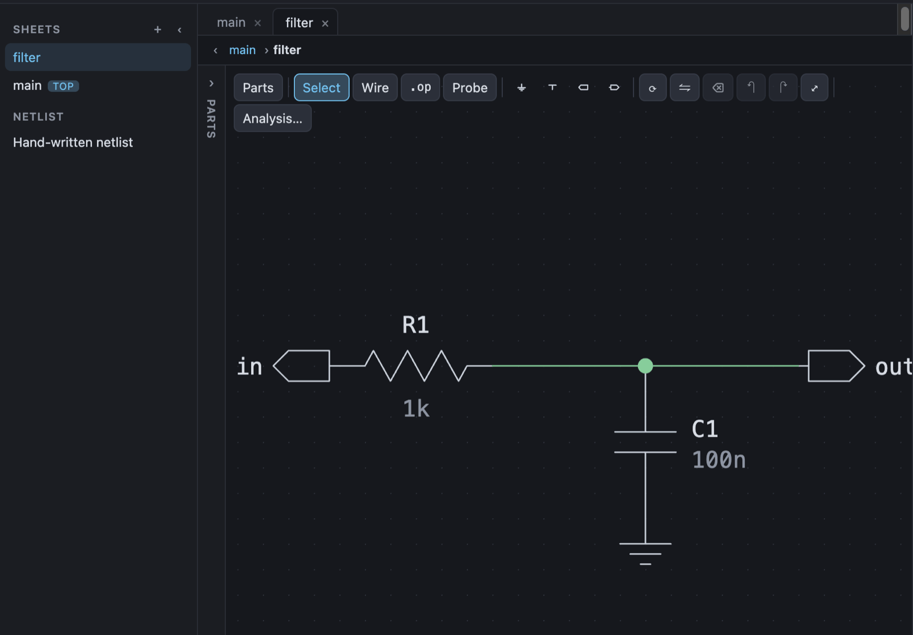

# 7. Projects and hierarchy

[Guide index](README.md) · Previous: [Sweeps and Monte Carlo](06-sweeps.md) · Next: [Component libraries](08-libraries.md)

## What is in a project

A project is a folder with the following layout:

```text
My amplifier/
  My amplifier.nsproj   project file: name, top sheet, imported libraries, run settings
  main.nsch             one file per sheet
  filter.nsch
  libs/                 library files imported into this project
```

All of them are plain JSON or SPICE text, so they work well with Git. To share a project, share the whole folder.

You can also work without a project: **Open file** (⇧⌘O) on the Home page opens a single `.nsch` schematic or a `.cir` netlist. The header then has **Schematic** / **Netlist** buttons and an **Open** button, and **Save As** (⇧⌘S) is available.

## Sheets

The **Sheets** panel on the left (⌘1) lists the project's sheets and a **Hand-written netlist** for typing SPICE directly. The panel works as follows:

- Click a sheet to open it in a tab. Close a tab with **×**; its changes stay until you save or discard them.
- **＋** adds a sheet. Type a name and press **Enter**.
- **✎** renames a sheet. Blocks that use it follow the new name.
- **⤒** makes a sheet the **top sheet**.
- **×** deletes a sheet (after a confirmation). The top sheet can't be deleted.

To find a part without knowing its sheet, press ⌘F (**Edit › Find…**) and type its reference, for example `R2` or `D14`, or a net label. Pick a match with the arrow keys and **Enter**, or click it: its sheet opens with the part selected.

The list shows the top sheet first, then the rest by name with numbers in order. Number the sheets to list them in signal order (`1-body`, `2-inamp`, … in the [ECG-Frontend](examples/ECG-Frontend/) example).

The **top sheet** (marked `TOP`) is the circuit that runs. **▶ Run** always simulates the top sheet, even when another sheet is on screen, and probing only works on the top sheet. The other sheets are used through blocks.

## Ports

A sheet becomes a reusable subcircuit when it has **ports**. A port is like a net label that also becomes a pin of the block. To add ports, do the following:

1. Open the sheet you want to reuse, for example a filter.
2. Press **H** (or **Place › Sheet Port**) and click on each net that should be a pin, at a pin end or wire end.
3. Name each port in the properties popup (**Port name**): `in`, `out`, `vcc`…

Ports follow these rules:

- Each port must be on its own net. Two ports on one net, or a port on ground, is an error.
- Port names can't contain spaces or `= ( ) , { } " '`.
- Analysis directives on a sub-sheet are ignored (with a warning). Only the top sheet's analyses run. Other directives, such as `.param` and `.model`, stay with the sheet.
- Ports on the top sheet act as net labels (with a warning).
- Power flags (`VCC`, `VEE`…) are global, like ground. A `VCC` flag on any sheet is the same net as the top sheet's `VCC`, so a sub-sheet's op-amps don't need supply ports. Net labels stay local to their sheet, and signals go between sheets through ports.

## Blocks

To place a block, do the following:

1. Open the sheet where you want to use the subcircuit.
2. Open the Parts panel (⌘2). Your other sheets are listed under **Sheets** at the bottom, with their port names.
3. Click the sheet and click on the canvas. A block appears: a box with one pin per port, the first half of the ports on the left and the rest on the right.
4. Wire the block's pins like any other part.

Each block is named X1, X2… and its value shows the sheet name. In the netlist, the sheet becomes a `.subckt` (written once, however many blocks use it) and each block becomes an `X` line.

Inside a block, nets are named `<block>.<net>`. For example, plot the net `qrs` inside block `XDET` as `v(xdet.qrs)`, and a part's current as `I(XLED.D1)`.

[examples/Hier-Filter](examples/Hier-Filter/) has two copies of `filter.nsch` (a 1 kΩ / 100 nF RC section) in cascade:


The AC plot shows the single-pole roll-off at `mid` and the steeper two-pole roll-off at `out`.

## Descending into a block

To see or edit the sheet behind a block, do one of the following:

- Double-click the block.
- Select it and press **Enter** (or right-click it and choose **Properties…**), then click **Open sheet** in the popup.

The sheet opens in a new tab, with a breadcrumb trail above the canvas (**main › filter**). Click **‹** or a name in the trail to go back up.



Edits inside the sheet change every block that uses it. Results and probing stay with the top sheet. To probe, switch back to it. The status bar reminds you if you try from a sub-sheet.

## Updating a block after its ports change

When you add, remove or rename a port on a sheet, the blocks that use the sheet must change shape. The app updates them when you leave the sheet (switch tabs or close it) and when you save. The block gets the new set of pins and the sheets it is on are marked as changed.

Wires follow their pins. Each wire end on a pin moves with it to the pin's new position. Pins are matched by name, so adding a port in the middle doesn't shift the others. Wires on a removed or renamed port stay where they were, so look for loose ends there. The new pin is unconnected (red square) until you wire it.


If a block's sheet was changed some other way (for example edited outside the app), the properties popup shows **Ports changed: …** and an **Update pins** button. A block whose pins don't match its sheet's ports stops the netlist with an error that says to update the block.

A sheet can't contain itself, directly or through other sheets. The netlister reports such loops as `Hierarchy cycle: …`.

Next: [Component libraries](08-libraries.md).
