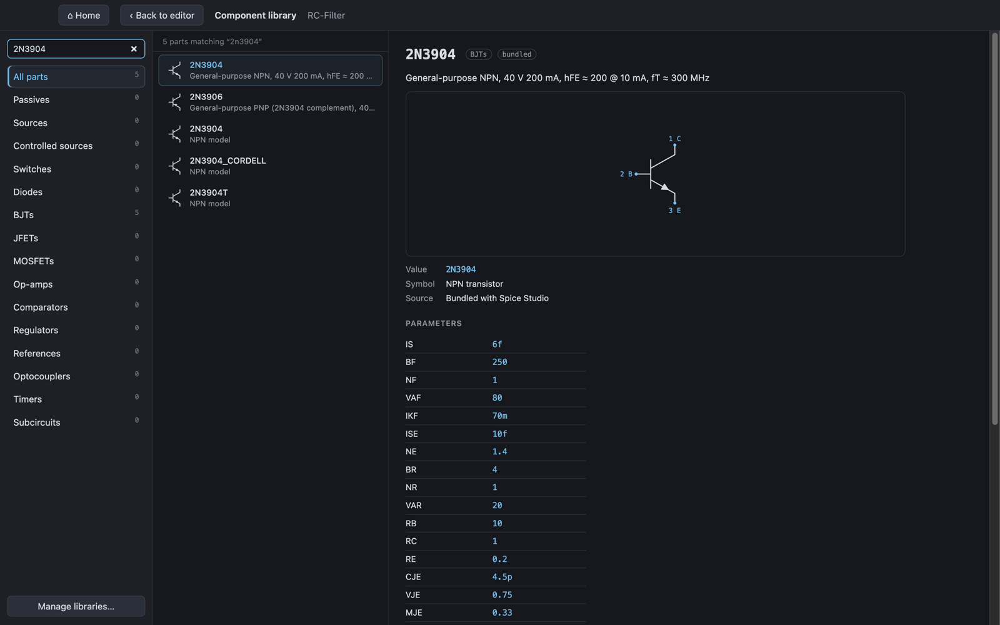
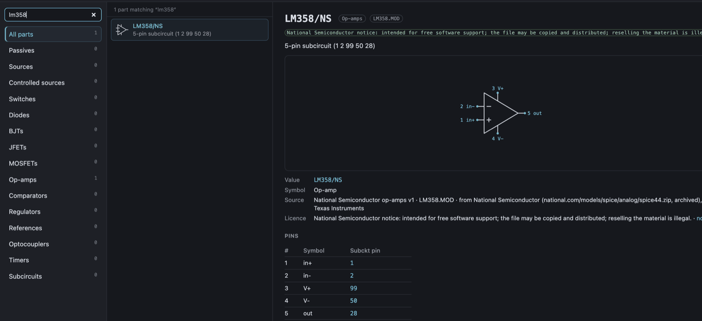
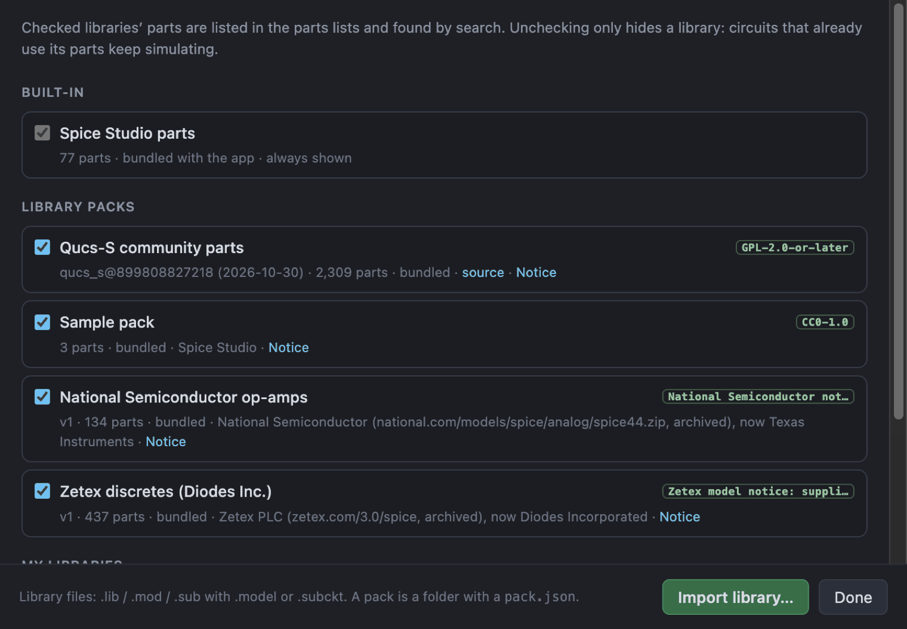
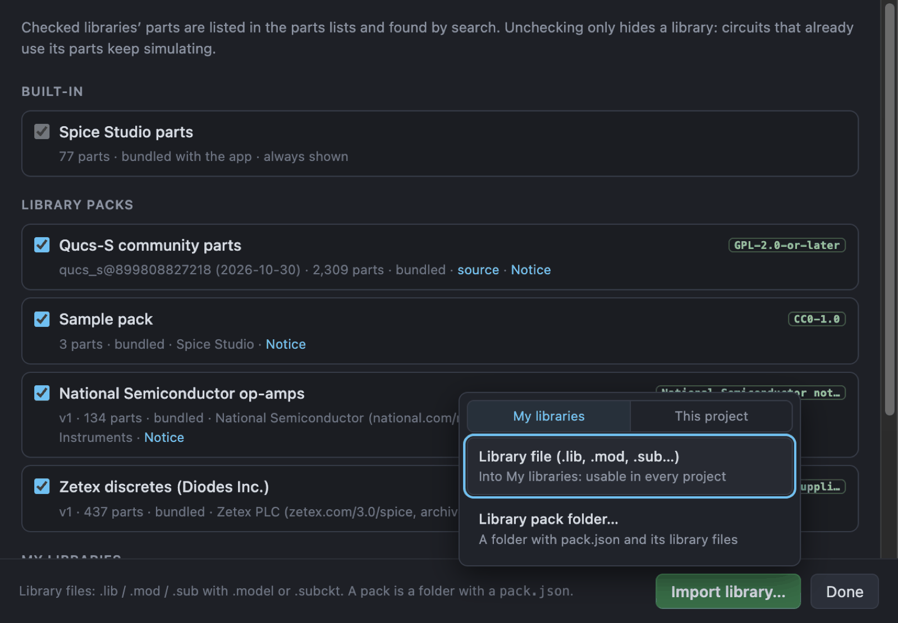

# 8. Component libraries

[Guide index](README.md) · Previous: [Projects and hierarchy](07-projects-and-hierarchy.md) · Next: [Exporting](09-exporting.md)

Spice Studio ships with a built-in library and several library packs: thousands of diodes, transistors, op-amps, references, regulators and more, each with its SPICE model. The [project README](../../README.md#component-libraries) lists the packs and their licences.

Libraries come from four places:

| Source | Where it lives | Who sees it |
|---|---|---|
| **Built-in** (*Spice Studio parts*) | inside the app | always shown |
| **Library packs** | bundled with the app, or a pack folder you add | every project |
| **My libraries** (your personal library) | the app's user-data folder | every project |
| **This project** | the project's `libs/` folder | this project only |

## Browsing the library

Open the full-page library with **Library** in the editor header, **Tools › Component Library**, or the **Component library** card on the Home page.

1. Pick a category on the left, or **All parts**.
2. Type in **Search library** to filter.
3. Click a part to see its details.

The detail card shows the symbol with numbered pins, the **Value** used on the schematic, the **Symbol**, where the part comes from (**Source**), its **Licence** for pack parts, its model **Parameters** and the **SPICE** text, with a **Copy** button. For subcircuits (op-amps, regulators…) a **Pins** table maps each symbol pin to the subcircuit's own pin:

To place a part, use the Parts panel in the editor ([chapter 2](02-drawing-schematics.md#placing-parts)); the library page is for reading. **‹ Back to editor** returns to your sheet.

## Manage Libraries

**Tools › Manage Libraries…**, or **Manage libraries…** at the bottom of the Parts panel or the library page, opens a separate window listing every library.

- Untick a library to hide it from the parts lists and search. Hiding doesn't break anything: circuits that already use its parts keep simulating.
- **Notice** shows a pack's licence, source and file checksums.
- **Remove** deletes a pack you added, a file in My libraries or a project library (after a confirmation). Built-in packs can't be removed.
- **Done** closes the window.

## Importing a vendor model (.lib, .mod)

Manufacturers publish SPICE models as `.lib`, `.mod`, `.sub` or similar text files containing `.model` and `.subckt` definitions. To use one:

1. Choose **Tools › Import Library…**, or open Manage Libraries and click **Import library…**.
2. In a project, choose where it goes:
   - **My libraries**: usable in every project.
   - **This project**: copied into the project's `libs/` folder, so it travels with the project.
3. Click **Library file (.lib, .mod, .sub…)** and pick the file.

   

4. The import dialog lists each `.model` and `.subckt` found in the file. For each one:
   - tick or untick it;
   - pick a **symbol** (for a `.model`, the matching device: diode, NPN, MOSFET…; for a `.subckt`, any symbol with the same number of pins, or **Block** for a generic box);
   - pick a **category** for the parts lists;
   - for a subcircuit, **map the pins**: for every symbol pin (in+, in−, V+, V−, out…) choose the subcircuit pin it connects to. The vendor's `.subckt` line, or the comment above it, says which node is which.
5. Fix anything shown in red (every symbol pin needs a different subcircuit pin) and click **Import** (or ⌘↵).

The new parts appear in the Parts panel under the category you chose. Models with no matching symbol (a switch model, for example) aren't listed, but they stay available to the subcircuits in the same file.

**Library pack folder…** in the same menu adds a whole pack: a folder with a `pack.json` file and its library files. See [`library-packs/`](../../library-packs/) for the format.

### How library parts travel with a project

When you place a part from **My libraries** or a pack in a project, the app copies its library file into the project's `libs/` folder and points the part at that copy (the status bar says `Using the project copy: …`). The project then simulates on another computer that doesn't have your personal library.

If two different library files define a model or subcircuit with the same name, the netlist stops with an error: ngspice would quietly use one model for both parts.

## Compatibility mode for PSpice and LTspice models

Many vendor models are written for PSpice or LTspice and use syntax or functions that plain ngspice reads differently or rejects. ngspice has compatibility modes for these; the app passes your choice to ngspice as `-D ngbehavior=ps`, `lt`, `ltps` or `kicad`.

1. Click **Run settings** in the header.
2. Set **Compatibility** to the simulator the model was written for: **PSpice**, **LTspice**, **LTspice + PSpice** or **KiCad**.
3. Click **Save** and run again.

The default, **Auto (from the parts' libraries)**, uses a mode only when a library pack says which dialect its models use. For your own imported files, set the mode yourself. The sign that you need it: ngspice errors that point at lines inside the vendor's model text rather than at lines you wrote.

The mode applies to the whole circuit. Turn it off again (Auto) if your other parts start to misbehave.

Next: [Exporting](09-exporting.md).
