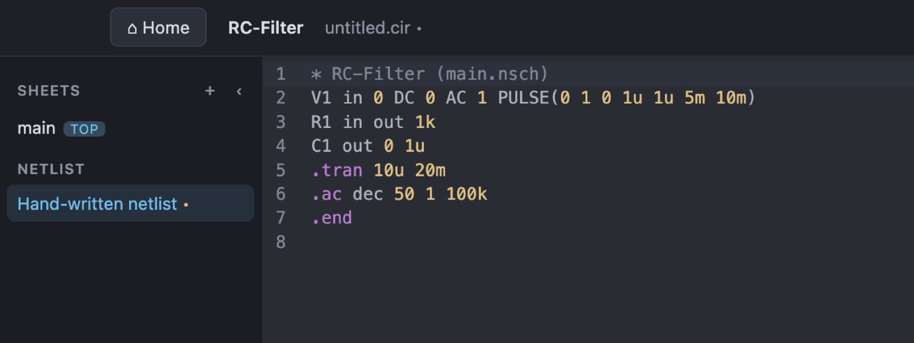

# 9. Exporting

[Guide index](README.md) · Previous: [Component libraries](08-libraries.md) · Next: [Troubleshooting](10-troubleshooting.md)

## Plots

Each plot has **PNG**, **SVG** and **CSV** buttons at the right of the hint line under it. The same commands are in **File › Export › Plot as PNG…**, **Plot as SVG…** and **Plot Data as CSV…**, which act on the plot on screen.

1. Set the plot up the way you want it: tick the traces, zoom, place cursors.
2. Click **PNG**, **SVG** or **CSV**.
3. Choose where to save it.

| Format | What you get |
|---|---|
| PNG | An image of the plot as shown, including the cursor lines |
| SVG | The same as a vector drawing, for reports and slides |
| CSV | The data of the ticked traces, one column per trace. AC traces get two columns: dB and phase in degrees. Sweep and Monte Carlo runs are included, labelled per run. In FFT view you get the spectrum |

The file name is suggested from the analysis, e.g. `transient.png`, or `transient-fft.csv` for an FFT.

## Schematics

With a sheet on screen:

- **File › Export › Schematic as SVG…** saves the sheet as a vector drawing.
- **File › Export › Schematic as PDF…** saves it as a PDF.
- **File › Print Schematic…** opens the system print dialog.

The export is black on white, cropped to the drawing, and leaves out the grid, the selection, the operating-point tags and the unconnected-pin markers. Directive cards, notes, shapes and the title block are included.

## Netlists

**File › Export Netlist…** saves the netlist of the top sheet as a `.cir` file, including the models and subcircuits of library parts and every block's `.subckt`. You can run it with ngspice yourself:

```sh
ngspice my-circuit.cir
```

The export refuses to run while the schematic has netlist errors; the status bar then says how many.

The exported file is what the app generates, without the extras it adds for a run (`.options savecurrents`, and the expansion of `.step` and `.mc`). Plain ngspice doesn't understand the app's `.step` and `.mc` directives, so remove them, or use ngspice's own `.control` loops, if you run a swept netlist by hand. Library parts that come from files on disk are written as `.include` lines with the file's full path.

To look at the netlist without saving it, click **View netlist** in the header. It opens in the netlist editor, where you can edit it, run it with **▶ Run** and save it with ⌘S.



Next: [Troubleshooting](10-troubleshooting.md).

## Bill of materials

In a project, click **Bill of materials…** (under **BOM** in the Sheets sidebar). A window opens with every component in the design, one line per value: Qty, Value, Type, the purchasing columns, References and Sheets.

- **Manufacturer**, **Part number**, **Supplier** and **Supplier part no.** are yours to fill in: click a cell and type (for example Yageo, `RC0603FR-0710KL`, Digi-Key, `311-10.0KHRCT-ND`). One entry covers the whole line, so all six 10k resistors share it. They're saved in the project file as you type, and the footer counts how many lines have a part number. Changing a part's value makes it a different line, with its own, empty details.

- It covers the whole design from the top sheet down. A part inside a block counts once per use of the block, and its reference carries the block's name: `XINA.R2` is `R2` on the sheet used by block `XINA`. Sheets that no block uses aren't listed.
- **Include sheets** (top of the window): untick a sheet to leave its parts out. All sheets are ticked to start with; **None** / **All** flips them together. Blocks placed on an unticked sheet still count, so unticking the top sheet only drops the parts drawn on it. Your choice is kept until you open another project.
- Sources, controlled sources, the ideal op-amp, couplings (K) and transmission lines are simulation elements, not components, so they're left out (the footer says how many).
- The list follows your edits, including unsaved ones.
- **Export CSV** and **Export Excel** save exactly what the window shows, as `.csv` or `.xlsx`, with the columns Qty, Value, Type, Library part, Manufacturer, Part number, Supplier, Supplier part number, References and Sheets. The `.xlsx` opens in Excel, Numbers, LibreOffice and Google Sheets.

In the [ECG-Frontend](examples/ECG-Frontend/) example, untick `1-body`: its resistors and capacitors stand for the patient and electrodes, not parts on the board.
