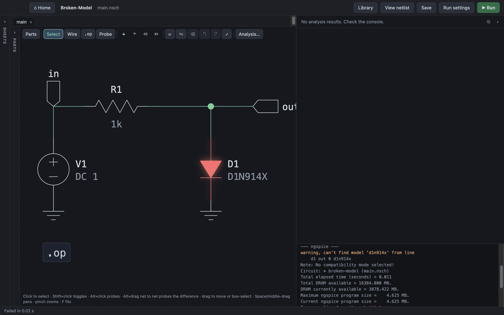

# 10. Troubleshooting

[Guide index](README.md) · Previous: [Exporting](09-exporting.md)

## Where to look

**The status bar** (bottom left) gives the outcome of the last run: `Done`, `Failed`, `Netlist errors (n)`, `Electrical rules check: …`, `Stopped` or `Timed out after … s`.

**The console** (under the plots) is the full log of the last run, in this order:

1. Warnings from the netlister and the rules check (`Warning: …`, `Error: …`).
2. `--- netlist ---`: the exact netlist sent to ngspice.
3. `--- ngspice ---`: everything ngspice printed. With a sweep, each run has its own `--- run R=1k ---` section. With `.meas`, a `--- .meas ---` section follows.

Warnings are yellow and errors red. When a line names a part or net on the schematic, the part is shown in red and clicking the line selects it on the top sheet.



The log is not saved to disk; it is replaced by the next run. To keep it, select the text in the console and copy it. **File › Export Netlist…** saves the netlist so you can run it in ngspice yourself ([chapter 9](09-exporting.md#netlists)).

**Tools › Simulation Engine…** shows which ngspice the app uses and where it is. If none is found, the Home page shows the engine name in red and the console says `ngspice was not found` and lists the places the app looked.

## Common errors

### "No ground"

`Error: No ground: add a ground symbol (G) to the circuit`. Every circuit needs a reference node. Press **G** and put a ground on the circuit's 0 V point. A net label called `0` or `gnd` also counts.

### Singular matrix

```
Warning: singular matrix:  check node out
```

ngspice can't solve the circuit because a node's voltage is undefined. Usual causes:

- **A node with no DC path to ground.** Every node needs a path to ground through resistors, inductors, sources or semiconductors. Capacitors and current sources don't count at DC. Typical cases: two capacitors in series, a capacitor-coupled input with no bias resistor, a floating op-amp input, or a transformer secondary that isn't grounded anywhere. The rules check warns `No DC path to ground from net …` before the run.
- **A loop of voltage sources or inductors** (the message names a `…#branch`). See below.

What to do: add a resistor to ground at the named node (a large value such as 1 MΩ or 1 GΩ is fine), or bias the node properly. As a stopgap, the convergence banner offers **Add a 1 TΩ resistor from every node to ground** (`.options rshunt=1e12`).

### Voltage-source loop

`Error: Loop of voltage sources / inductors: V1, V2 (a short circuit at DC)` from the rules check, or `V1 is shorted: both ends are on net …`.

Two voltage sources in parallel, an inductor straight across a voltage source, or an E/H output across a source all ask for an infinite current at DC. The rules check stops the run and marks the parts in red ([chapter 4](04-simulating.md#the-electrical-rules-check)).

What to do: remove one source, or add a small series resistance (for example 1 mΩ to 1 Ω) to model the wiring or the inductor's winding resistance.

### Can't find model

```
warning, can't find model 'd1n914x' from line
    d1 out 0 d1n914x
...
could not find a valid modelname
```

The part's value names a model that isn't in the netlist. Causes:

- A typo in the value.
- A model name typed by hand into a plain part. Place the part from the Parts panel instead, so the library brings its model ([chapter 3](03-components.md#semiconductors)), or define it yourself with `.model` or `.include` in a directive.
- A library part whose library is missing. The inspector then says `Unknown library part …`. Import the library again ([chapter 8](08-libraries.md#importing-a-vendor-model-lib-mod)) or check the project's `libs/` folder.
- A model written for PSpice or LTspice that ngspice can't parse, so the model never gets defined. Try the compatibility mode in **Run settings** ([chapter 8](08-libraries.md#compatibility-mode-for-pspice-and-ltspice-models)).

### Timestep too small

```
doAnalyses: TRAN:  Timestep too small; time = 0.002, timestep = 1.25e-18: trouble with dmod-instance d1
```

During a transient run, ngspice had to shrink its time step to almost nothing to follow a change, and gave up. The message gives the time and often the part involved. Common causes:

- Ideal, instantaneous edges: switches with very low on-resistance, sources with zero rise and fall times, ideal diodes switching hard.
- An inductor current that is suddenly interrupted with nowhere to go (it produces a huge voltage spike). Add a snubber (an RC across the switch) or a clamp diode, as in the [Flyback](examples/Flyback/) example.
- Unrealistic values: a 1 fF capacitor next to 1 kΩ in a millisecond simulation, or gains of 10¹².

What to do: give edges a finite rise and fall time, add small series resistances and parasitic capacitances, and limit the step with a **Max step** in the `.tran` line. The convergence banner offers `cshunt=1e-12`, `method=gear`, and `reltol=3e-3 itl4=100`.

### No convergence in the operating point

`No convergence in the DC operating point` in the banner (ngspice prints messages such as `gmin stepping failed`, `source stepping failed` or `Too many iterations without convergence`).

ngspice couldn't find a DC solution. Check the circuit first: a transistor or op-amp with no bias, positive feedback, or a part with an extreme value. Then try the banner's fixes (more iterations, finer source or gmin stepping, larger `gmin`). You can also help ngspice with a starting guess: `.nodeset v(out)=2.5`.

### Other messages

| Message | Meaning |
|---|---|
| `No analysis directive (.op, .tran, .ac, .dc, …)` | Add an analysis ([chapter 4](04-simulating.md)) |
| `R1 pin 2 is unconnected` | A pin with nothing on it; look for the red square |
| `Net has several labels (a, b); using "a"` | Two differently named labels are on one net |
| `F1: controlling voltage source "V1" is not on this sheet` | F, H, W and K values must name an element on the same sheet |
| `X1: SPICE needs names starting with "R", using RX1` | The part's name doesn't start with its SPICE letter, so the app added it |
| `Port "in" is connected to …; each port needs its own net` | Two ports, or a port and ground, share a net |
| `X1: pins (…) don't match the ports of "filter.nsch" (…); update the block` | See [chapter 7](07-projects-and-hierarchy.md#updating-a-block-after-its-ports-change) |
| `.step sweep needs 120 runs (max 50)` | Reduce the number of `.step` values |
| `.mc cannot be combined with .step: use one or the other` | Remove one of them |
| `Timed out after 30 s` | The run took longer than the **Timeout** in Run settings |

Back to the [guide index](README.md).
